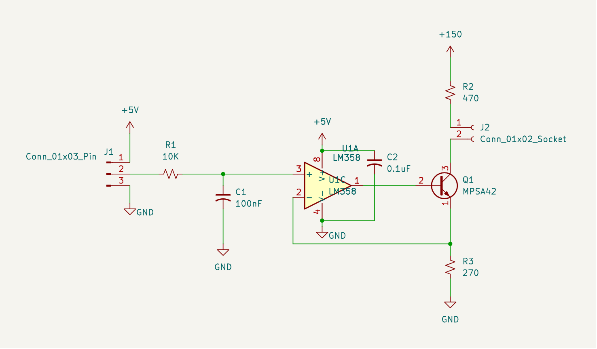
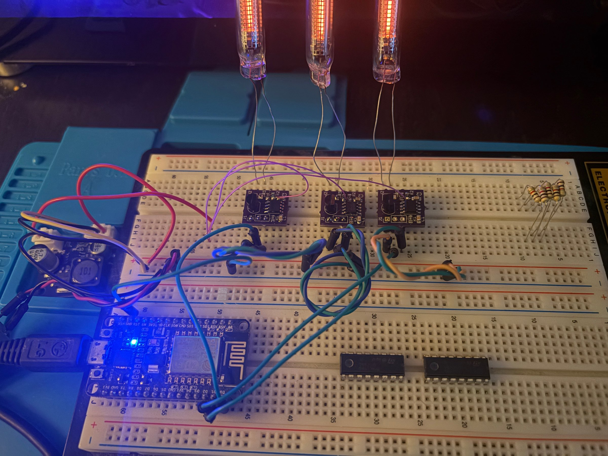
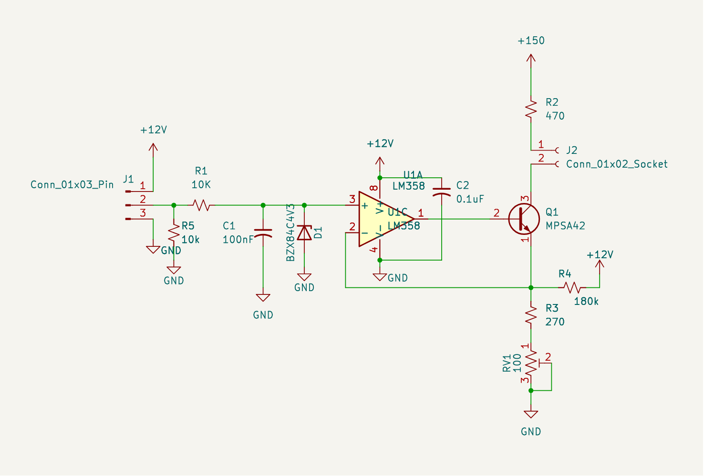
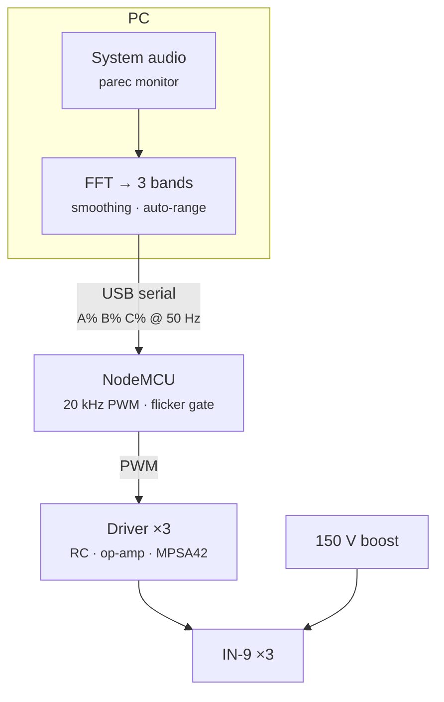
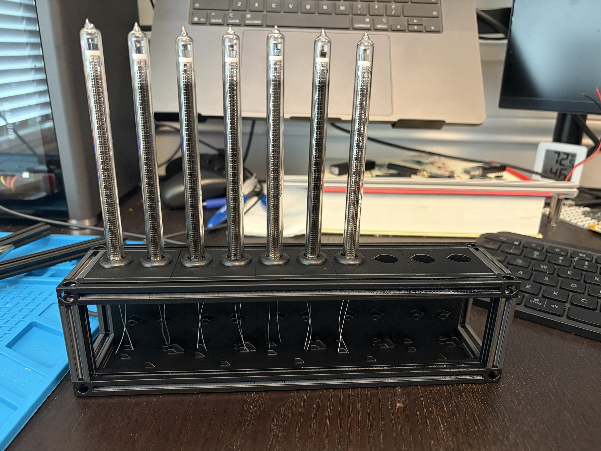

This is part one of a series about building an audio spectrum analyzer out of IN-9 neon bar-graph tubes. The end goal is a finished piece that sits on a shelf as functional art: a row of glowing neon columns dancing to whatever's playing. Before committing an enclosure and PCB fabrication, I wanted to verify my driver design. This post covers that feasibility work: a small analog driver board, firmware that turns serial commands into PWM, and a host script on the PC that turns system audio into a simple 3-band display.

# Background
### The IN-9
The IN-9 is a Soviet-era linear gas-discharge indicator: a long, thin glass tube filled with neon, with a straight anode wire running alongside a cathode. When the tube strikes, the cathode glows orange-red, and how far up the tube the glow reaches is set by how much current you push through it. More current, longer bar. It was built to be a bar-graph meter, so it's a natural fit for a spectrum analyzer, and it has the same warm neon glow as a Nixie tube. Elektor's [Nixie bargraph thermometer](https://www.elektormagazine.com/labs/nixie-bargraph-thermometer-with-arduino) project has a good introduction to the tube's construction and its quirks.

Like a Nixie, it needs high voltage to strike, so the system runs off a 150V boost supply. The difference is in how you control it. A Nixie is digital: a cathode is either lit or not. The IN-9 is analog: the bar length tracks the tube current, from a few milliamps to around 12mA for a full-length bar ([datasheet](https://xdevs.com/doc/Nixie_Tubes/russian_nixie_tubes/IN-9/in9.pdf)). So the driver isn't a switch, it's a programmable current source that can hold the tube at any point in between.

# The driver board
### From PWM to current
A microcontroller can't output an analog current, but it can output PWM. The driver converts that PWM into a regulated tube current in three stages:

1. **Filter.** A 10k / 100nF RC low-pass (R1, C1) averages the 3.3V PWM into a DC voltage proportional to duty cycle. Its corner is about 160Hz (a 1ms time constant), which smooths the 20kHz carrier into a steady level while still following the music.
2. **Op-amp.** An LM358 compares that voltage against the voltage at the bottom of the transistor and drives the transistor's base until they match.
3. **Current sink.** An MPSA42, a 300V NPN transistor, sits below the tube's cathode with a 270Ω resistor (R3) under its emitter.



The trick is that the op-amp's feedback comes from the emitter, not from its own output. The op-amp forces the emitter voltage to equal the filtered input voltage, so the current through R3 is `Vin / 270Ω`. That same current flows up through the collector and through the tube, so 3.3V at 100% duty gives about 12.2mA, right around a full-length bar.

Putting the transistor inside the feedback loop is what makes this work. If the op-amp just drove the base open-loop, the transistor's ~0.65V base-emitter drop would eat the bottom fifth of the 3.3V range, and the bar would drift as the transistor warmed up. With the transistor inside the loop, the op-amp quietly adjusts for both, and the tube current tracks the input.

### The board
I laid it out as a tiny single-channel board in KiCad: an SOIC LM358, the TO-92 MPSA42, a handful of 0805 passives, a 3-pin header for power, PWM, and GND, and a header for the tube. The +150V and tube nets carry 150V, so they got their own netclass and a custom DRC rule enforcing 0.4mm of clearance from everything else.

.")
{.half}

For the prototype, three of these boards went onto a breadboard alongside the NodeMCU and a small 150V boost converter module, one board per tube.



### Revising the driver
Building and testing the first circuit turned up a handful of changes, which went into a revised schematic:



- **12V op-amp rail.** The LM358's output can't swing all the way to its positive supply; it tops out around 1.5V below it. On 5V that's about 3.5V, short of the ~3.95V (3.3V plus the base-emitter drop) needed to reach full scale. Moving the op-amp to 12V gives it plenty of headroom.
- **RV1 (100Ω trimmer)** in series with R3 sets each tube's full-scale current, from about 12.2mA (3.3V across 270Ω) down to about 8.9mA (3.3V across 370Ω). That matters because no two IN-9s are quite alike.
- **R4 (180k)** feeds a small current (tens of microamps) from 12V into the emitter node. That nudges the sense voltage up slightly, so at 0% input the op-amp drives the transistor fully off instead of leaving a faint glow from the LM358's offset.
- **D1 (4.3V Zener)** clamps the op-amp input, so a 5V PWM source can't overdrive the tube.
- **R5 (10k)** pulls the PWM input low, so a disconnected or rebooting microcontroller leaves the tube dark rather than floating.

# Firmware
### PWM over serial
The firmware is deliberately dumb: it accepts a line of text with one percentage per channel (`42.5 60 80`), converts each to a 10-bit duty cycle, writes it to a 20kHz PWM pin, and replies with an acknowledgement. Everything interesting happens on the PC.

It started with one channel on D0, grew to two (D0, D1), and then to three (D0, D1, D2) for the 3-band display. The serial protocol stayed the same throughout:

```text
> 25 50 75
< PWM set to 25.0 50.0 75.0.
> flicker 85 50
< Flicker on (85.0 Hz, 50% on).
```

The host waits for each acknowledgement before sending the next command, so the board never gets flooded and a missed reply shows up as a timeout instead of a silently dropped frame.

### Flicker
The firmware also gates all of the PWM outputs on and off at 85Hz, with a 50% on-time by default. Both the rate and the on-time can be changed over serial with `flicker <Hz> [on%]`, or turned off entirely.

The reason is historical: IN-9s were [often driven with half-wave rectified current](https://www.elektormagazine.com/labs/nixie-bargraph-thermometer-with-arduino) rather than DC, so the tube saw pulses at mains frequency rather than a steady current. Gating the drive at 85Hz reproduces that pulsed operation.  Introducing the flicker helps ensure the tubes glow starts at its base and ends at the point as dictated by the current.  I found without it the glow is more prone to "jumping" where only a portion of the filament is glowing.

# Host software
### From audio to bars
The PC side is a single Python script, `pwm_test.py`. It started as a test harness (sweeps, sawtooths, and fixed levels to check that each tube responds linearly across its range) and grew real modes once that worked.

It captures system audio with `parec` from the monitor of the default PulseAudio/PipeWire sink, so whatever is playing on the PC drives the tubes with no extra cabling. Two meter modes sit on top of that:

- **`vu`**: a classic level meter. Left channel to tube A, right to B, the mix to C.
- **`eq`**: the 3-band spectrum display.

```bash
./pwm_test.py -p /dev/ttyUSB0 eq
```

### Three bands
For `eq`, the script mixes left and right to mono and runs an FFT every 10ms over a sliding 2048-sample (46ms) Hann window. The FFT bins are summed into log-spaced bands, each covering the same number of octaves, so pink noise (roughly the average tilt of music) reads the same in every band. With the default 50Hz to 16kHz span and three bands, that works out to about:

| Tube | Band |
| --- | --- |
| A | 43 – 345 Hz (bass) |
| B | 345 Hz – 2.3 kHz (mids) |
| C | 2.3 – 16 kHz (highs) |

Each band's power is smoothed with separate attack and release time constants (30ms up, 150ms down), so bars jump up on a transient and fall back gracefully instead of jittering. Levels are converted to dBFS and mapped onto bar length through an auto-ranging window. The window snaps out to new extremes instantly and relaxes back over a few seconds, so the display stays lively whether the music is quiet or loud. By default the three bands share one window, which preserves their relative heights so you can actually see the shape of the spectrum. `--per-band` gives each band its own window if you'd rather have every tube fill its range.



### Calibrating the tubes
One thing that only showed up with real tubes is that they don't all reach the top at 100% PWM, and they don't all stop at the same place. The revised board's trimmer handles the coarse full-scale current per board, and the script takes a `--tube-max` per channel (for example `--tube-max 80,75,90`) describing how far each tube actually lights at full PWM. Every value the script sends is a bar length rather than a duty cycle, rescaled so that "50%" really means half of what that tube can show.

Here's the whole chain running: system audio on the PC, through the `eq` mode, out over serial to the three tubes.



# Where this leaves off
The prototype answered the question it was built for. A PWM pin, an RC filter, and an op-amp current sink give smooth, stable, linear control of an IN-9's bar length, and a PC can feed three of them a live spectrum over serial at 50 updates a second.

It also showed where three tubes stop scaling. The ESP8266 has about seven clean PWM pins and generates PWM in software, so ten tubes at 20kHz is beyond it. Ten tubes at 12mA each also draw about 120mA from the 150V rail, around 18W, which is more than many small boost modules are rated for. Part two covers the first step toward ten: a dual-channel driver board designed almost entirely by AI. Later parts cover scaling the PWM side up to ten bands and designing a physical assembly to hold the tubes. As a preview, the frame is already printed:



And here's a render of where it's all headed:


