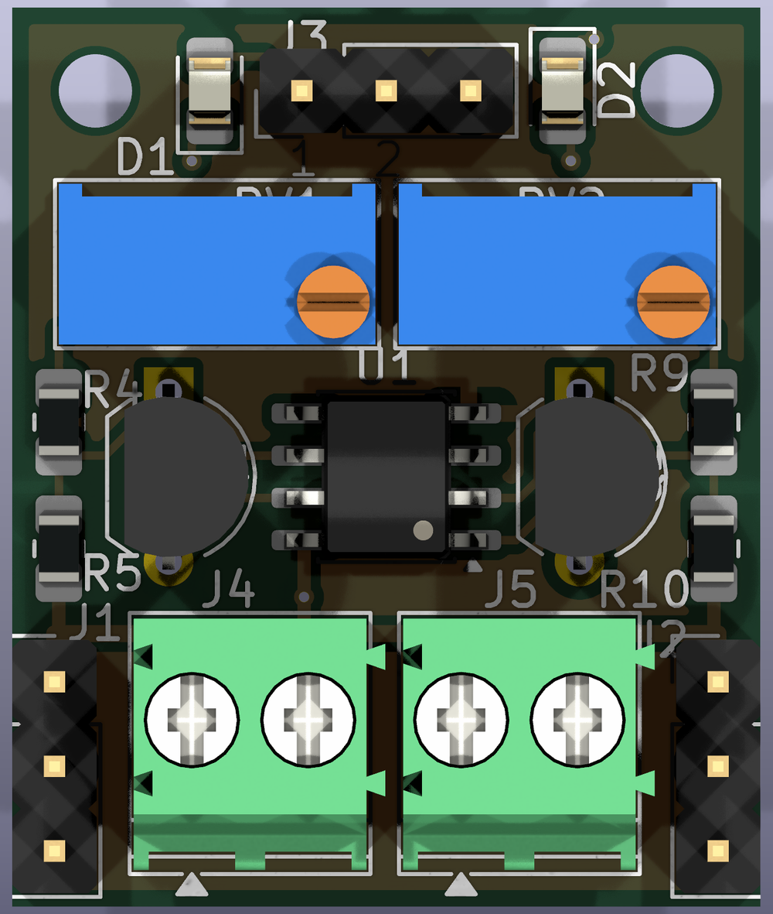
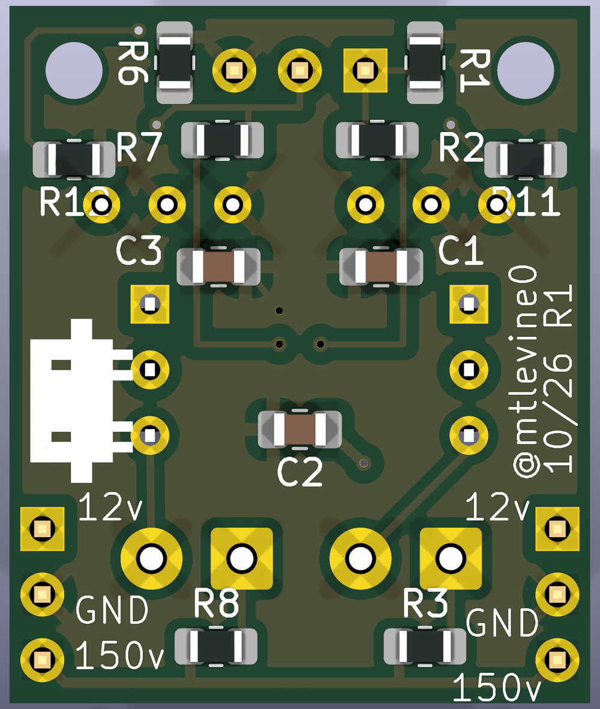

[Part one]() of this series proved out an analog driver for IN-9 neon bar-graph tubes: a PWM input, an RC filter, and an op-amp current sink, one small board per tube. Taking the learnings from the prototype I dedicded to try and design the next revision using AI native tooling for Kicad 10. It's the furthest I've pushed AI-assisted PCB design so far.

# Konnect
The glue is [Konnect](https://github.com/mixelpixx/Konnect), an MCP server, installed as a KiCad 10 plugin, that gives Claude a toolbox for KiCad: placing and editing schematic symbols, wiring nets, building hierarchical sheets, syncing the schematic to the board, placing footprints, routing, and running ERC and DRC. It works against KiCad's own data model rather than treating `.kicad_sch` and `.kicad_pcb` files as text. That matters, because KiCad files are object graphs full of UUIDs and cross-references, and text edits are an easy way to quietly corrupt a design. Konnect also comes with a skill that enforces this: every change goes through the MCP tools, and Claude re-queries the design to confirm each one landed.

# Revising the circuit
Building and testing the breadboard prototype from part one turned up a handful of changes to the single-channel circuit, which went into a revised schematic before any of the new board work started:

- **12V op-amp rail.** The LM358's output can't swing all the way to its positive supply; it tops out around 1.5V below it. On 5V that's about 3.5V, short of the ~3.95V (3.3V plus the base-emitter drop) needed to reach full scale. Moving the op-amp to 12V gives it plenty of headroom.
- **RV1 (100Ω trimmer)** in series with R3 sets each tube's full-scale current, from about 12.2mA (3.3V across 270Ω) down to about 8.9mA (3.3V across 370Ω). That matters because no two IN-9s are quite alike.
- **R4 (180k)** feeds a small current (tens of microamps) from 12V into the emitter node. That nudges the sense voltage up slightly, so at 0% input the op-amp drives the transistor fully off instead of leaving a faint glow from the LM358's offset.
- **D1 (4.3V Zener)** clamps the op-amp input, so a 5V PWM source can't overdrive the tube.
- **R5 (10k)** pulls the PWM input low, so a disconnected or rebooting microcontroller leaves the tube dark rather than floating.

# From one channel to two
The single-channel prototype board from part one was laid out with Claude too, using an earlier KiCad MCP server. This board went further. Claude rebuilt the schematic hierarchically, with one `channel` sheet holding the circuit and a `pair` sheet instantiating it twice, so both channels stay identical by construction. It's the revised circuit above, doubled up, with a few more changes:

- **One LM358 for both channels.** It's a dual op-amp, so the second half no longer sits unused.
- **Screw terminals for the tubes**, since IN-9 leads are fine wire that doesn't plug into a header well.
- **PWM indicator LEDs** on each input, for checking at a glance that the board is getting a signal.
- **No Zener clamps.** A schematic review flagged that 4.3V Zeners can leak at 3.3V, and the PWM source is always the 3.3V NodeMCU, so they came out.

# Layout and routing
I provided Claude with the following contraints:

- The board can be double-sided, but only resistors, capacitors, and diodes may go on the back.
- Boards will be fabbed in batches and mounted side by side, with jumper tabs carrying 12V, GND, and 150V from one board's power header to the next. So the power headers have to sit flush with the board edges, and their spacing is critical.
- At least two M2 mounting holes.

From there Claude worked the placement into a 22.5 × 27 mm outline, with power headers J1 and J2 flush on the side edges, the PWM header J3 at the top, the tube terminals along the bottom, and the passives tucked underneath. The board was then routed with [Freerouting](https://github.com/freerouting/freerouting), an open-source autorouter, against the board's design rules. Those rules include the HV netclass and the custom clearance rule keeping the 150V nets 0.4mm away from everything else. Claude ran ERC and DRC after each pass; the final board is ERC clean with zero DRC errors and zero unconnected nets.

{.half}

{.half}

# Takeaways
I don't have very much experience in laying out PCBs with EDA tools.  This is only my fourth attempt at a PCB.  This is the first time I've used an "AI First" approach where Claude did most of the work and I just guided it. What I came away with is that the AI is plenty good at the tedious, rule-bound parts of PCB design: keeping hierarchical sheets consistent, honoring constraints & clearances, checking DRC every time, aliging layouts perfectly, and tidying silkscreen. What it can't do is decide what the board should be. The constraints that made this layout work (flush headers, batch tiling, which parts may go on the back) came from me, and the quality of the result tracked how clearly I stated them.
