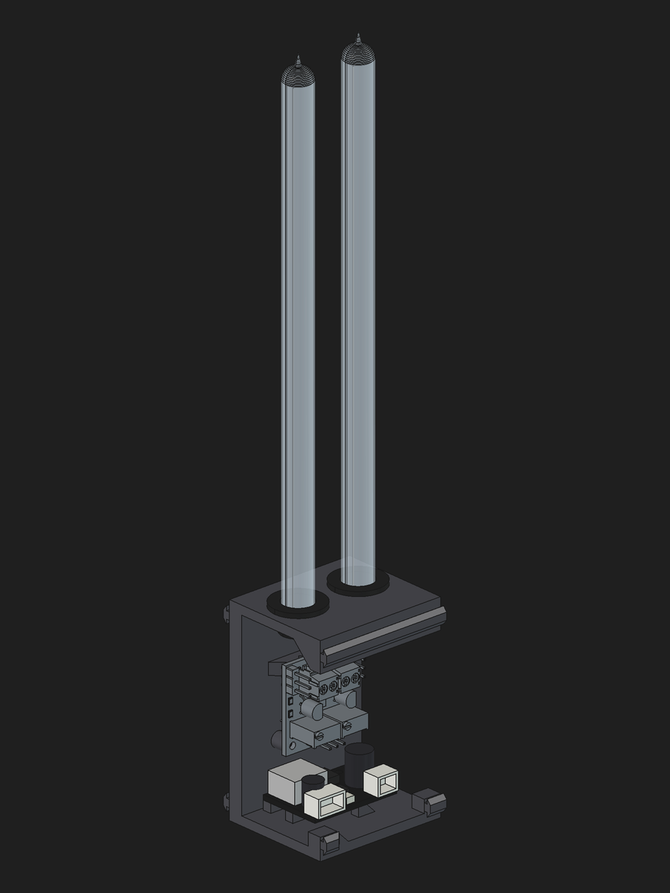
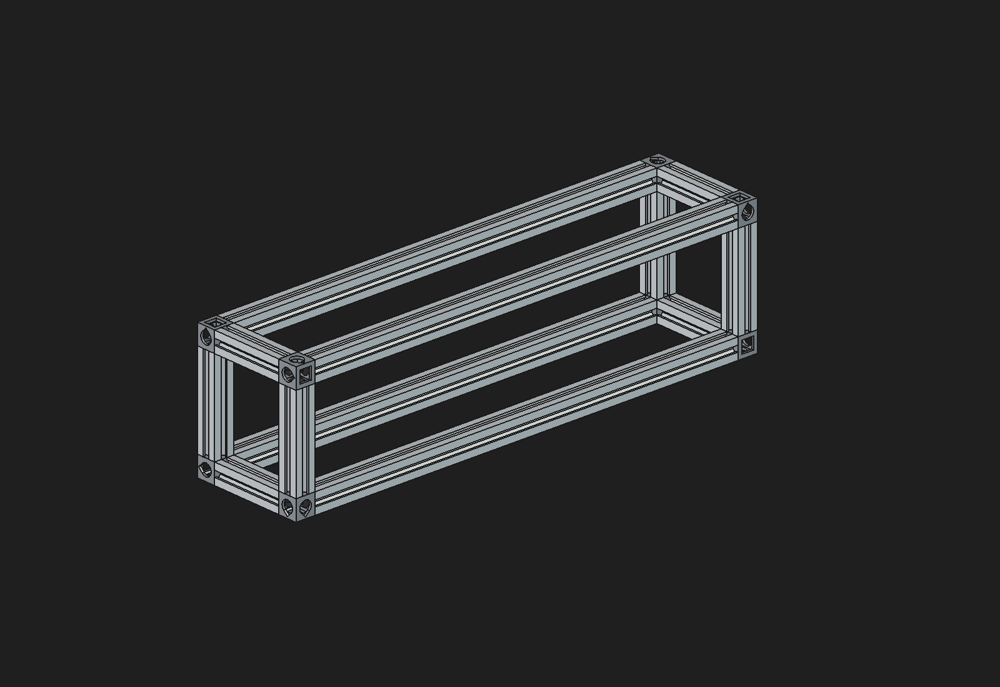
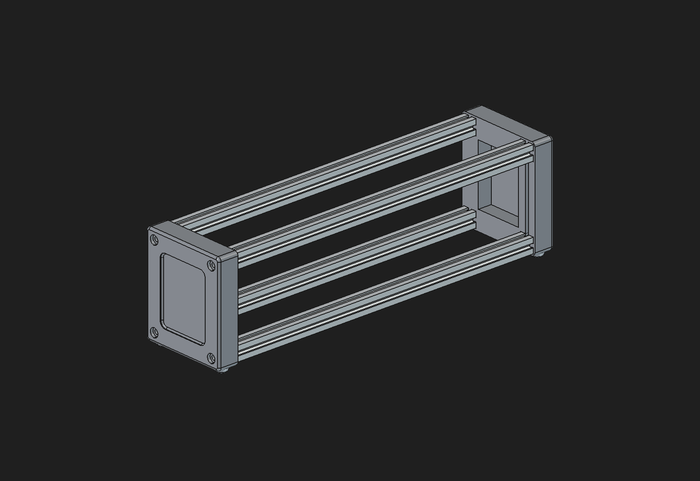
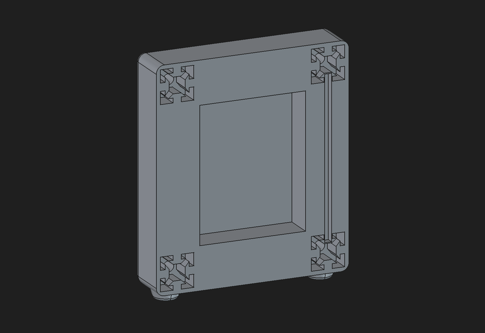
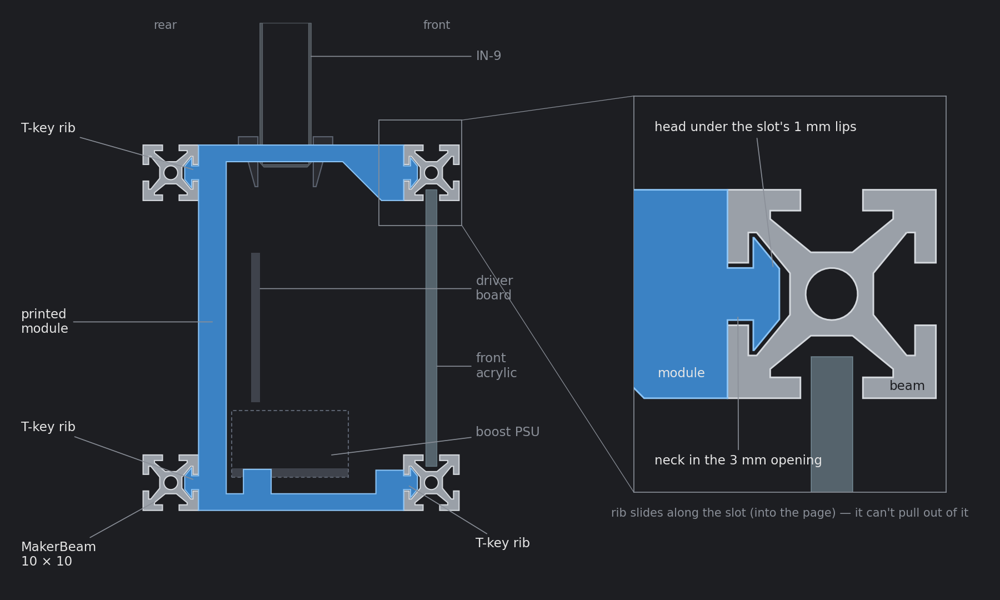
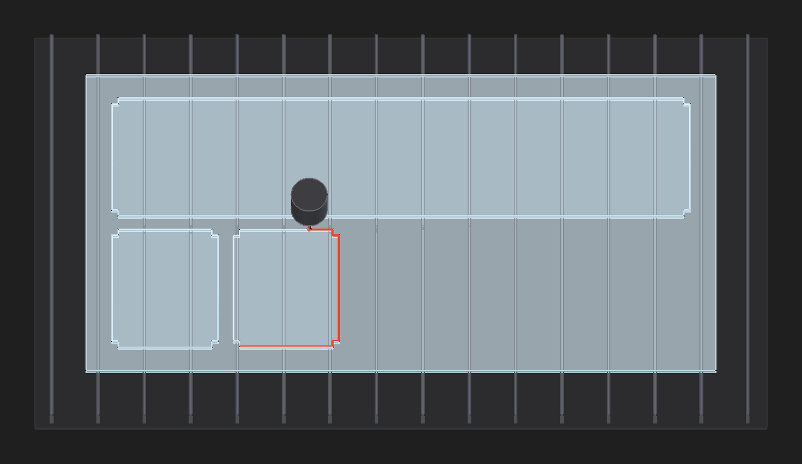
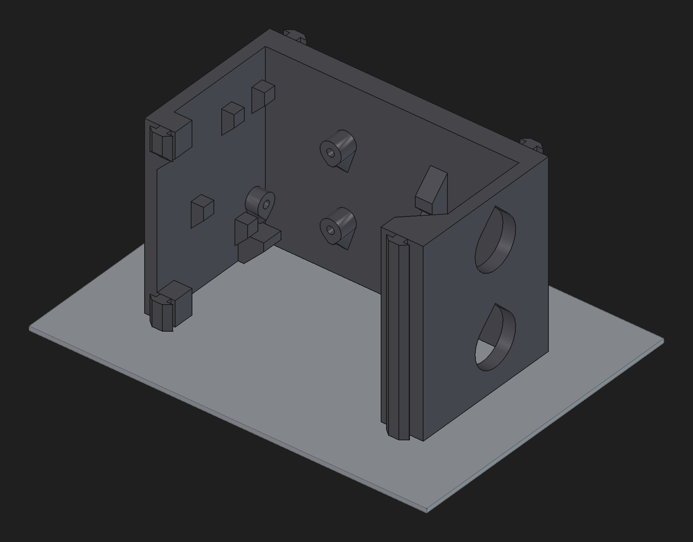
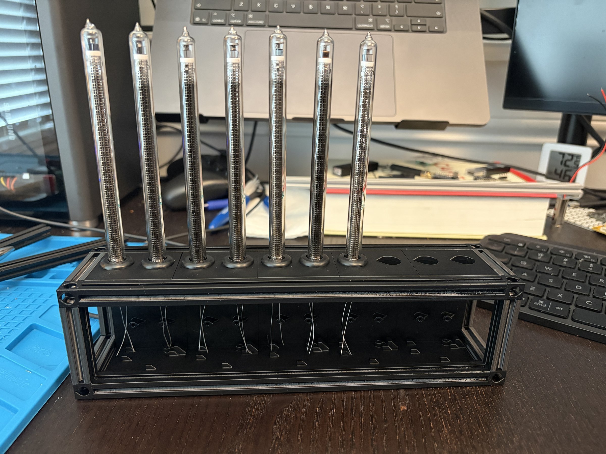

[Part two]() ended with a dual-channel driver board small enough to tile. This post covers the mechanical side: the enclosure that holds ten IN-9 tubes, five driver boards, and five boost PSUs in a row, designed in FreeCAD.

<!-- TODO: why FreeCAD, and why this needed real CAD rather than eyeballing it like the part 1 frame. -->

# The design
Ten tubes stand in a row at 22 mm pitch, in five printed two-tube modules. Each module is one C-shaped print: the boost PSU on its floor, a dual driver board on its back plane, and two tubes in grommets in its roof. A MakerBeam 10 × 10 aluminium frame with printed corner cubes is the structure. The modules hold onto it with T-key ribs on their back face and front posts that slide along the beams' T-slots, so nothing is bolted. A printed tube bracket near the tips keeps the tubes aligned, gripping the glass with crush ribs, and clear acrylic panels close the front and sides.

The rest of the post covers how Claude built it, then how the design got here and each part in detail.

# Parametric from scripts
None of the parts were drawn by hand. Every part is a FreeCAD Python script, and the `.FCStd` files and STLs are generated from them:

- `tube_module.py` builds one two-tube module: the printed body, grommets, tubes, the driver board (imported as a STEP straight from KiCad), and the PSU.
- `psu_model.py` models the 30 × 21 × 12 mm boost PSU from a photo of the listing.
- `makerbeam.py` models the MakerBeam profile, a printable corner cube, and the frame hardware.
- `in9_assembly.py` places five modules in the frame, adds the tube bracket and acrylic panels, prints the panel cut sizes, and exports the STLs.

The assembly derives every number from the module's parameters, so changing the module width or height carries through to the beam lengths and cut list.

Scripts are also what made it practical to hand the CAD work to Claude. A FreeCAD document is a binary blob of features and placements, but a Python script is something an agent can read, diff, and edit like any other code.

# Claude driving FreeCAD
As with the PCB in part two, Claude did most of the modelling and I steered. The tooling is a bit different, though.

## FreeCAD MCP
[FreeCAD MCP](https://github.com/neka-nat/freecad-mcp) has two halves: an addon that runs inside FreeCAD and serves an XML-RPC API on `localhost:9875`, and an MCP server that wraps that API as tools for Claude: creating and editing objects, inspecting the document, and running arbitrary Python in the FreeCAD GUI.

## From photos and drawings to models
The other parts had no STEP files, so Claude modelled them from a product photo, a dimensioned drawing, or a caliper reading. Anything guessed is marked as an estimate in the code.

- **Boost PSU:** outline and height from the listing, components placed by reading the photo.
- **MakerBeam:** the slot profile traced off MakerBeam's drawing and extruded.
- **Corner cube:** sized from the stock MakerCube STL, then redrawn to print without supports.
- **Grommets:** from the listing's drawing. The 3 mm groove sets the module's roof thickness.
- **IN-9 tube:** a revolved profile at the 9.3 mm diameter I measured with calipers.

The pattern: start from the listing, then swap in measurements as real parts arrive. A new measurement is a one-line change and a rebuild, and the clash checks and asserts flag anything it broke.

## Checking its own work
The weak spot of an agent doing CAD is that it can't see what it built unless you give it a way to. Every change went through the same loop before Claude reported back:

1. **Clash check.** Boolean intersections between every pair of solids in global placement, reporting `common().Volume`. Some overlaps are expected, like the cube screws in the beam bores, or the bracket's crush ribs biting into the glass. Any other non-zero volume is a real clash.
2. **Asserts.** The scripts assert the geometry rules that are easy to break: the front posts sit beside the PSU and below its plugs, and the T-key ribs land on the beam centrelines and fit the slot opening. A failing assert means the design needs fixing, not the assert.
3. **Screenshot.** A snippet run through the same RPC saves a 1600 × 1100 view of the model, and Claude reads the PNG back to look at it.
4. **Overhang audit.** After a change to a printed part, Claude scans the exported STL for downward-facing facets steeper than 45°.

The screenshot step caught the kind of thing numbers don't, like a part that was technically clash-free but sitting in the wrong place.

## An AGENTS.md for the mechanical design
A long CAD session outlives Claude's context, so the design knowledge had to live in the repo. `assembly/AGENTS.md` is the quick start: the design in one paragraph, what each script does, the coordinate system and object naming, how to run FreeCAD live or headless, the verification loop, and the design rules to keep (printable without supports, nothing bolted, the frame is the structure).

It also collects the FreeCAD scripting gotchas Claude hit along the way, so the next session doesn't hit them again:

- `shape.translate()` and `rotate()` on a `Part.Shape` only change its placement. Assigning `.Placement` later quietly throws the move away. Baking it in needs `transformGeometry()`.
- Parts repeated with `App::Link` only report their true position through `getGlobalPlacement()`, which matters a lot when the clash check is the safety net.
- The FreeCAD GUI caches imported modules, so every rebuild needs `importlib.reload`.
- Front is the driver-board side, +Y. That got flipped once and had to be corrected across every script, so now it's written down.

## What it couldn't do
Claude is good at keeping a parametric model consistent: changing one module parameter and chasing it through the frame, the cut list, the asserts, and the STLs is exactly the tedious work it doesn't mind. It's much less good with dimensions nobody has measured. The PSU model's mounting hole and part positions are estimated from a photo of the listing, and the MakerBeam slot cavity is only approximate, so the guide tells Claude not to build tight fits on them. That's why the T-key ribs have clearance in the slots rather than a snug fit.

The tube bracket proved the point. The first one was designed before I'd measured the tubes, around the nominal 10 mm diameter, and its crush ribs never touched the 9.3 mm glass.

Like the board constraints in part two, the inputs that matter still come from me, and from calipers.

# How the design evolved
<!-- TODO: trim or expand. v1–v3 had no screenshots kept. -->
The design went through five versions before it settled:

1. **v1:** a first tube module, a 50 × 30 mm PSU, and a ten-tube chassis.
2. **v2:** tube modules stacked on a tier of upright PSUs, with each module split into a spine and a cap.
3. **v3:** a smaller 30 × 21 mm boost PSU lying flat in a printed tray under each pair of tubes.
4. **v4:** a MakerBeam 10 × 10 frame with corner cubes around one-tube modules joined by lap joints, all bolted to the beams.
5. **v5:** two-tube modules, each carrying its own PSU and dual driver board, held by nothing but the frame.

v4 worked on paper, but every single-tube module was lap-jointed to its neighbours and bolted to the beams, which added up to a couple hundred fasteners. With an external frame now doing the structural work, the modules could be rethought around it instead of being bolted to it.

# The two-tube module
Each module is one C-shaped print, 44 × 37 × 65.9 mm, two tube pitches wide:

- **Floor:** the boost PSU lies flat, mounted by a single M2 screw.
- **Back plane:** one dual driver board stands centred on two M2 bosses. The board has parts on its back face, so the rest pads and boss tips are placed to clear them. The trimmers' leads clear the back plane by 0.08 mm.
- **Roof:** two tubes in grommets, with a 16.4 mm gap above the board for wiring the tube leads into the screw terminals.
- **Front lip:** a 4 mm rib under the roof's front edge that stiffens it to carry the tubes.
- **Front posts:** two short posts at the floor's front corners, beside the PSU and below its plugs.
- **Sides:** open, so the 12V and PWM wiring runs along the row as one tunnel.

The driver boards' power headers land 21.5 mm from the next board's, so neighbouring modules link with short leads. Those links should carry only 12V and GND: each module has its own PSU driving just its two tubes, and paralleling five 150V outputs isn't a good idea.

# The frame
The frame is an exoskeleton of MakerBeam 10 × 10 aluminium, sized to sit flush with the modules' top, bottom, front, and back. Four 220 mm long beams run along the row, front and rear, top and bottom. Each end has two crossbars and two uprights, and a printed corner cube joins the beams at each of the eight corners, with an M3 button head through the cube into each beam's tapped end. With the frame on, the whole display is 240 × 57 × 65.9 mm, not counting the tubes.

MakerBeam is sold in 300 mm lengths, usually in packs of four. The frame needs twelve pieces in three lengths: four 220 mm long beams, four 45.9 mm uprights, and four 37 mm crossbars. That's 1211.6 mm of beam, just over the 1200 mm in one pack, so it takes two packs. Allowing 2 mm per saw cut, five of the eight beams cover it:

| Beam | Cuts | Offcut |
|---|---|---|
| 1–4 | 220 + 45.9 | ~32 mm |
| 5 | 37 + 37 + 37 + 37 | ~146 mm |
| 6–8 | spare | 300 mm |

Each beam's 220 mm piece takes most of it, and the 80 mm left over only fits one short piece, so the crossbars come out of a fifth beam. Every cut end also needs its centre bore tapped M3 for the corner cube screws.

One alternative I'm considering: make each end of the frame one printed piece, with the two uprights, two crossbars, and four corner cubes as a single cap. Each cap is 14 mm thick and stands 1.5 mm proud of the beams all round. The four long beams, lengthened to 232 mm, slide 6 mm into sockets in its inner face. Each socket has a T-key on every wall, the same profile as the modules' ribs, that guides the beam in by its slots and stops it twisting. An M3 screw from the outside into each beam's end pulls it home.

The cap also closes the end: a 3 mm panel fills the opening, sunk 1.5 mm below the cap's outer face, so the side acrylic panels go away too. Being printed, the cap can also be shaped in ways the aluminium can't: rounded corners and edges, a soft-cornered recess, and two small feet under each end that lift the display off the desk. The frame is then four beams from one pack, two prints, and eight M3 screws instead of 24. A groove in each cap's front upright takes the front panel's edge, like the beam slot it replaces.

# Modular assembly with minimal hardware
The modules hold onto the frame with T-key ribs that slide along the long beams' inner T-slots: the back face's top and bottom ribs in the rear beams, and the lip and front post ribs in the front beams. The rib heads sit under the slot lips, so a module can only come out along the slots. Assembly is: take one end of the frame off (its uprights, crossbars, and cubes come away as one piece), slide the five modules in, put the end back on. The end crossbars hold the row in place.

The acrylic panels follow the same no-fastener rule. The front and two side openings are closed by 2 mm clear acrylic, its edges sitting in the beam slots that face each opening, with a notch at each corner to clear the cubes. The front panel slides in along the long beams with the modules, and each side panel goes in as its end of the frame goes back on. The assembly script prints the cut sizes.

That took the hardware list from v4's couple hundred fasteners to 24 M3 button heads for the corner cubes and 15 M2 self-tappers for the boards and PSUs.

# The tube bracket
The tube bracket keeps the tops of the tubes at the same 22 mm pitch as the grommets, and parallel. It sits at the tube tops, just above the glowing column: a ring around each tube, joined by a thin spine behind the tubes so as little as possible stands in front of them. Three crush ribs in each ring grip the glass, and nothing else holds it: it presses down over the tube tips last, with no fasteners of its own.

Getting that grip right took measuring, not modelling. After the first bracket's ribs missed the 9.3 mm glass entirely, I printed a grip test, a strip of rings at candidate diameters with each one labelled, to tune the fit against real tubes.

# Printable without supports
Every printed part had to print without supports:

- The module prints lying on its left face, so the C-profile is flat and every wall and rib grows straight up.
- Any face that would overhang is bevelled at 45°, and the screw bosses print as tapered teardrops.
- The stock MakerCube corners were replaced with a printed cube: 1.2 mm walls, a chamfered ceiling, and teardrop holes.
- The 220 mm frame beams can also be printed, as a 2 × 2 cluster with snap-off ties holding them straight during the print.

# Seeing it lit
FreeCAD screenshots are fine for checking clearances, but not for seeing what the display will look like lit. For that, Claude drove Blender through [Blender MCP](https://github.com/ahujasid/blender-mcp), which, like the FreeCAD addon, runs Python inside the live app.

1. **Export and import:** the assembly went out of FreeCAD as meshes and into Blender with materials by part: silver aluminium, dark PLA, rubber grommets, and the boards.
2. **Tubes:** rebuilt as clear glass with the exhaust tip and a nickel anode. That profile later went back into `tube_module.py`.
3. **Stills:** a low-sample test render before every change, which Claude checked before rendering the finals in Cycles.
4. **Glow:** after looking up photos of lit IN-9s, an orange-red core and halo per tube, with bloom in the compositor.
5. **Animation:** a sine wave keyframed along the row with an orbiting camera, rendered headless on the GPU and encoded with `ffmpeg`.



It isn't engineering, but a lit mock-up from the real CAD geometry is a cheap way to see if it's worth building before printing anything.

# What's next
So far the only thing built is the quick prototype frame: a 3D print of 10 × 10 mm extrusion, holding seven tubes to see them standing in a row, with no driver boards, PSUs, or wiring. The PCBs, driver components, and additional tubes are in the mail from Oregon, China, and Ukraine. I've committed to building at least two of these displays.

In the next post I'll begin assembling the final version and building the MCU driver board, its firmware, and host audio software.

<!-- TODO: printing and assembling it for real, controller/firmware, wiring. -->
