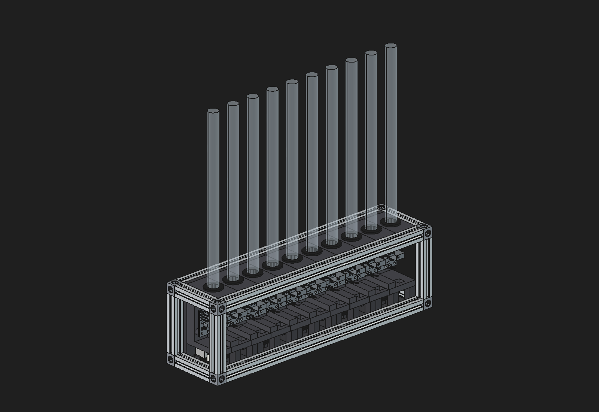
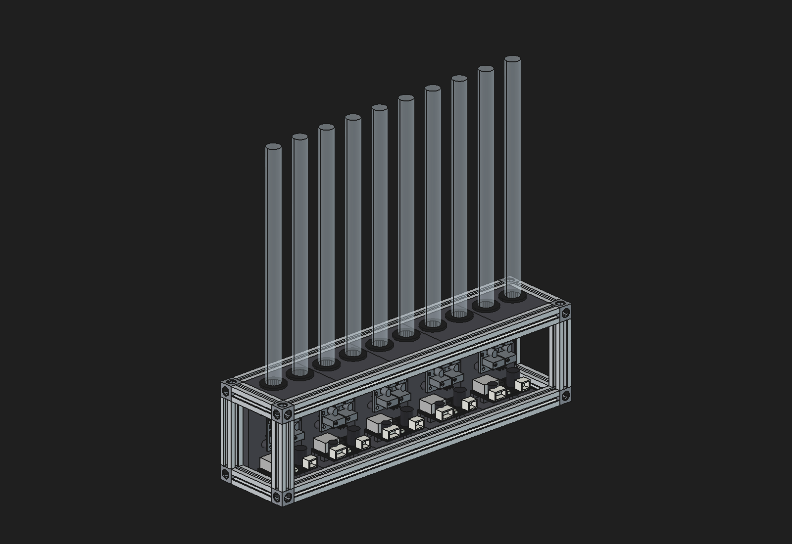
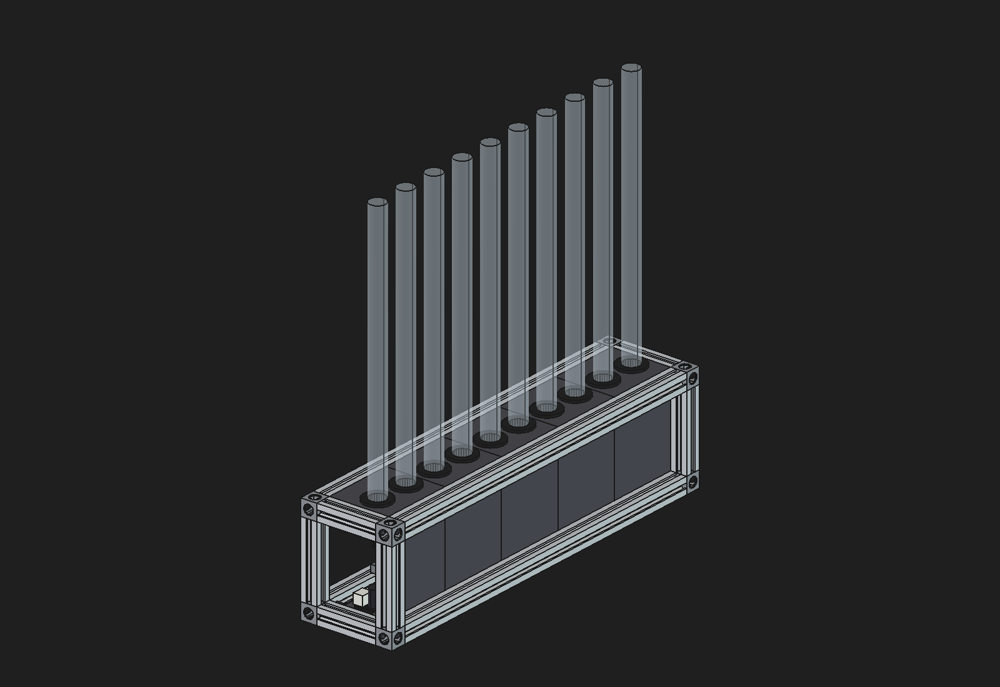
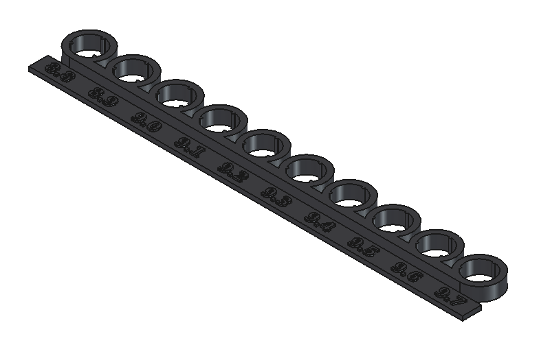

[Part two]() ended with a dual-channel driver board small enough to tile. This post covers the mechanical side: the enclosure that holds ten IN-9 tubes, five driver boards, and five boost PSUs in a row, designed in FreeCAD.

<!-- TODO: why FreeCAD, and why this needed real CAD rather than eyeballing it like the part 1 frame. -->

# Parametric from scripts
None of the parts were drawn by hand. Every part is a FreeCAD Python script, and the `.FCStd` files and STLs are generated from them:

- `tube_module.py` builds one two-tube module: the printed body, grommets, tubes, the driver board (imported as a STEP straight from KiCad), and the PSU.
- `psu_model.py` models the 30 × 21 × 12 mm boost PSU from a photo of the listing.
- `makerbeam.py` models the MakerBeam profile, a printable corner cube, and the frame hardware.
- `in9_assembly.py` places five modules in the frame, adds the tube bracket and acrylic panels, prints the panel cut sizes, and exports the STLs.

The assembly derives every number from the module's parameters, so changing the module width or height carries through to the beam lengths and cut list.

<!-- TODO: how Claude fit in. It drove FreeCAD live over the FreeCADMCP addon's XML-RPC port, clash-checked every change with boolean intersections, and screenshotted the result before reporting back. What worked, what didn't. -->

# How the design evolved
<!-- TODO: trim or expand. v1–v3 had no screenshots kept. -->
The design went through five versions before it settled:

1. **v1:** a first tube module, a 50 × 30 mm PSU, and a ten-tube chassis.
2. **v2:** tube modules stacked on a tier of upright PSUs, with each module split into a spine and a cap.
3. **v3:** a smaller 30 × 21 mm boost PSU lying flat in a printed tray under each pair of tubes.
4. **v4:** a MakerBeam 10 × 10 frame with corner cubes around one-tube modules joined by lap joints, all bolted to the beams.
5. **v5:** two-tube modules, each carrying its own PSU and dual driver board, held by nothing but the frame.

v4 worked on paper, but the hardware list told the story: 89 heat-set inserts, 60 square-head bolts, 29 socket heads, and 25 board screws. Moving to the dual-channel board made a two-tube module the natural unit, and that let the PSU, the driver, and both tubes live in a single printed part.

# The two-tube module
Each module is one C-shaped print, 44 × 37 × 65.9 mm, two tube pitches wide:

- **Floor:** the boost PSU lies flat, connectors facing front with 10 mm of plug clearance. That clearance sets the module's depth.
- **Back plane:** one dual driver board stands centred on two M2 bosses. The board has parts on its back face, so the rest pads and boss tips are placed to clear them. The trimmers' leads clear the back plane by 0.08 mm.
- **Roof:** two tubes in grommets, with a 16.4 mm gap above the board for wiring the tube leads into the screw terminals.
- **Sides:** open, so the 12V and PWM wiring runs along the row as one tunnel.

The driver boards' power headers land 21.5 mm from the next board's, so neighbouring modules link with short leads. Those links should carry only 12V and GND: each module has its own PSU driving just its two tubes, and paralleling five 150V outputs isn't a good idea.

# Nothing is bolted
The modules hold onto the frame with T-key ribs that slide along the long beams' inner T-slots: on the back face, top and bottom, on the lip, and on the front posts. The rib heads sit under the slot lips, so a module can only come out along the slots. Assembly is: take one end of the frame off, slide the five modules in, put the end back on. The end crossbars hold the row in place.

That took the hardware list from v4's couple hundred fasteners to 24 M3 button heads for the corner cubes and 15 M2 self-tappers for the boards and PSUs.

# Printable without supports
Every printed part had to print without supports:

- The module prints lying on its left face, so the C-profile is flat and every wall and rib grows straight up.
- Any face that would overhang is bevelled at 45°, and the screw bosses print as tapered teardrops.
- The stock MakerCube corners were replaced with a printed cube: 1.2 mm walls, a chamfered ceiling, and teardrop holes.
- The 220 mm frame beams can also be printed, as a 2 × 2 cluster with snap-off ties holding them straight during the print.

<!-- TODO: photo of a printed module / first test prints. -->

# The tube bracket
Ten tubes 161 mm tall, held only at their base, won't stay parallel. A thin printed bracket near the tips fixes that: a 2 mm ring per tube on a spine behind the row, held on by friction alone. Three round-nosed crush ribs in each ring grip the glass.

The first bracket's ribs never touched the glass. The IN-9 is nominally 10 mm, but my tubes measure 9.25–9.3 mm. So the fit is now tuned with a grip test: one ring for each grip diameter from 8.8 to 9.7 mm, labelled, printed, and tried on real tubes. 9.1 mm was the snug one.

# Acrylic panels
Clear 2 mm acrylic closes the front and both ends, edges sitting 2 mm into the beam slots and corners notched to clear the cubes. The front panel slides in along the long beams with the modules; each side panel goes in as its end is assembled. The script prints the laser-cut sizes.

# What's next
<!-- TODO: printing and assembling it for real, controller/firmware, wiring. -->
