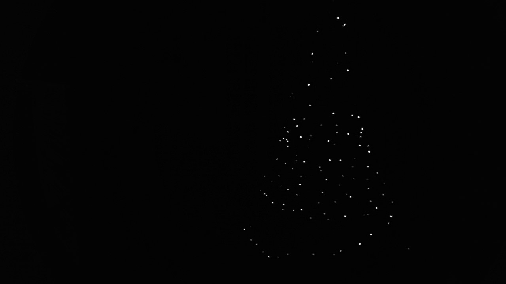
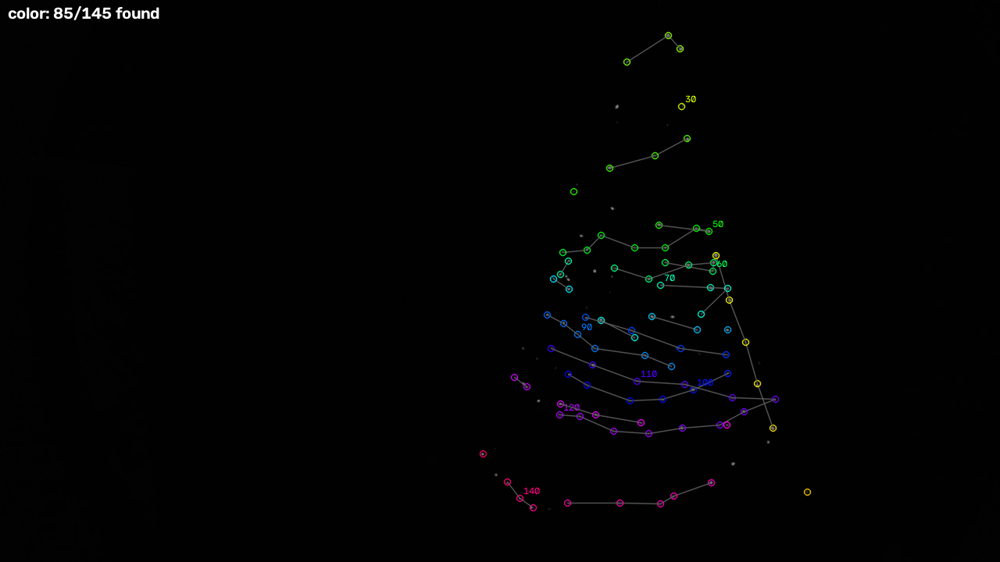
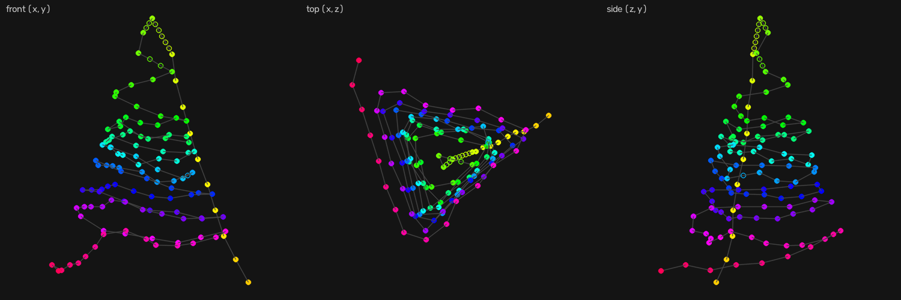
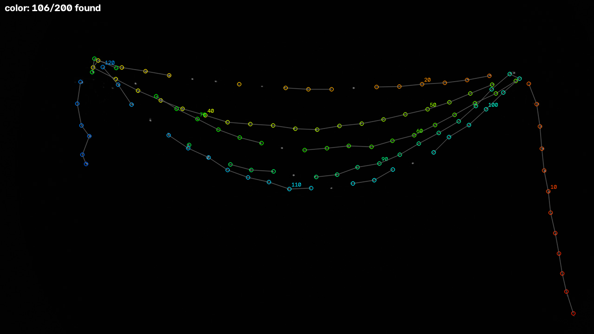
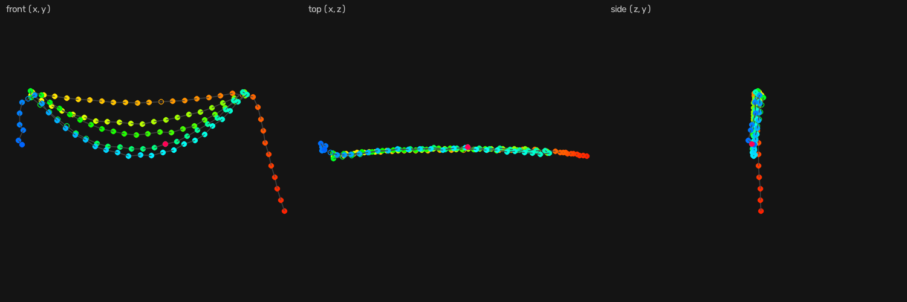

<!-- TODO: cover video. The tripod running a 3D effect (radar, barber or snow), filmed on a phone. Swap it in for the cover image too.

-->

Addressable LED effects are usually written along the strip. LED 0 is red, LED 1 is a little less red, and so on. That works when the strip is a straight line or a neat grid. Wrap it around a tree and a "rainbow" turns into colors spiraling around the branches in whatever order you happened to wind the strip.

The fix is to know where each LED is. With a position for every LED, an effect becomes a function of space and time, `color = f(x, y, z, t)`. A horizontal line sweeps up the object no matter how the strip was wound. Lighting software calls this pixel mapping. For a matrix you can type the layout in. For a strip wound by hand, measuring 200 LEDs with a ruler isn't realistic.

This series is about getting that map from a camera instead. The LEDs are flashed in a known pattern, a camera finds them, and a few views from different angles give their 3D positions. This post covers the proof of concept, a small Python tool. It worked better than I expected.

# The setup
The test object is deliberately boring: a tripod with a strip of WS2812B LEDs wrapped around it. It has height, depth and LEDs on every side, and some LEDs are always hidden behind the legs.

<!-- TODO: photo of the tripod with the strip wrapped around it, lit.

{.half}
-->

The strip is 200 LEDs on an ESP32 running [WLED](https://kno.wled.ge/). WLED already handles the strip, the Wi-Fi and the power limiting. It also accepts realtime frames over the network, so the computer can set every LED directly. The tool sends frames as [DDP](http://www.3waylabs.com/ddp/) packets on UDP port 4048. Each packet is a 10-byte header followed by raw RGB bytes. WLED falls back to its own effect 2.5 seconds after the last frame, so a frame held while the camera settles is resent every second to keep it from timing out.

The camera is an ordinary webcam with exposure set manually. Auto exposure fights you here. It brightens the image whenever the LEDs go dark, and then the "off" frames look like the "on" frames.

# Finding the LEDs
The simplest way to find each LED is to light one at a time and look for the bright spot. That takes one frame per LED, so 200 frames. Each frame has to wait for the LEDs to update, the Wi-Fi packet to arrive and the camera to deliver a new image. That's a few minutes per view.

Binary codes cut that down. In frame *k*, every LED whose index has bit *k* set is lit. After 8 frames each spot in the image has an 8-bit on/off history, and that history is its index. The tool uses Gray code, where neighboring indices differ in only one bit, so one misread bit usually lands on a neighboring LED rather than a random one.

This worked well for a flat 2D map with the camera on a tripod. It fell apart as soon as the camera was handheld. Each frame is compared with the others pixel by pixel. If the camera moves a few pixels between frames, every LED's history smears across its neighbors' pixels. A 3D map needs views from all around the object, so moving the camera has to be cheap.

# Color codes
The fix was to keep every LED on in every frame and put the code in its color. Each LED shows red, green or blue, and the sequence of colors over 9 frames spells its index. Three colors over 9 frames gives far more codes than 200 LEDs need, so the codebook can afford two rules:

- **No LED shows the same color twice in a row.** Every LED changes color in every frame. A frame where most LEDs kept their color is stale, either a dropped packet or a camera that hadn't caught up, so it gets thrown away and shot again. Frames are checked by what they show, not by how long the tool waited.
- **Any two codes differ in at least two frames.** One misread color produces a code that doesn't exist, not the wrong LED. If one frame is missing entirely, the other eight still identify the LED.

```python
for k in range(2, 16):
    seqs = [s for s in itertools.product(range(3), repeat=k)
            if s[0] != B and all(a != b for a, b in zip(s, s[1:]))]
    chosen = []
    for s in seqs:
        if not chosen or (np.array(chosen) != s).sum(axis=1).min() >= 2:
            chosen.append(s)
            if len(chosen) == n:
                return np.array(chosen)
```

Because every LED is lit in every frame, every frame shows the whole constellation of LEDs. The tool finds the bright spots in each frame and lines them up with the reference frame using a similarity transform (shift, rotation and scale). Image registration is the computer vision term for this alignment. Camera shake is removed this way, and so is a strip swaying slightly. Decoding then works per spot, not per pixel. Each LED's position is the median of where it appeared across all the frames.

A capture is 13 frames: one dark frame, all-red, all-green and all-blue reference frames, then the 9 code frames. The reference frames also record how this camera sees each LED in each color. A cheap webcam's "green" isn't always clearly green, and saturated LED centers look white. That's why color capture uses a lower exposure than white strobing.





Two LEDs close together sometimes merge into one spot and produce a garbled code. Those spots get a second pass. LEDs that were identified stay on dimly as anchors for registration, and only the candidates for an unresolved spot are flashed one at a time.

# From 2D to 3D
One view gives each LED a pixel position, which is a direction from the camera, not a point in space. A second view from a different angle gives a second direction, and the LED sits where the two rays cross. That's triangulation. It needs to know where each camera was and how it sees, and that's normally the hard part. The usual approach is to calibrate the camera with a printed checkerboard and place it with markers.

The LEDs make that unnecessary. In structure from motion, the hard step is matching the same point across photos. Here every LED has already told the camera its index, so the matches are known before the math starts. The reconstruction runs in four steps:

1. **Start from a pair.** Pick the two views that share the most LEDs and are far enough apart. Their shared LEDs give the relative pose of the two cameras (OpenCV's essential matrix and `recoverPose`). Triangulate those LEDs.
2. **Add views one at a time.** Each new view sees some LEDs that are already placed, which is enough to solve where that camera was (PnP). Then triangulate any LEDs that are now seen from two or more views.
3. **Bundle adjustment.** Refine every camera pose, every LED position and the camera's focal length together, minimizing the distance between where each LED was seen and where the model says it should appear.
4. **Orient.** Scale is arbitrary, so the map is normalized to the range -1 to 1. "Up" is the average camera up direction, since people hold cameras roughly level.

The camera's field of view doesn't need to be known. The tool tries field-of-view guesses from 35° to 100° and keeps the one that fits best. Bundle adjustment then refines it. It picked 68° for the webcam and refined that to 67.2°.

The tripod took seven handheld views, moving about 45° around it between captures. Neighboring views have to share LEDs, or the next camera can't be placed.

```
initial pair: views 1,6, 67 shared LEDs, median ray angle 71.5 deg
view 3: registered from 51/52 LEDs, +24 new LEDs
view 0: registered from 64/66 LEDs, +13 new LEDs
...
bundle adjustment: 7 views, 114 LEDs, 556 observations,
  reprojection median 0.55px / max 2.70px, 2 outlier observations dropped,
  f=963.5px (fov 67.2 deg)
```

The median reprojection error is about half a pixel. When the 3D map is projected back into each photo, the LEDs land within half a pixel of where the camera actually saw them.



Of the 145 LEDs on the tripod, 114 were triangulated. Another 10 were filled in by interpolating along the strip, which works for short runs of missed LEDs between two found ones. The remaining 21 are mostly hidden behind the legs or pointed straight away from every view.

<!-- TODO: confirm the LED count. WLED reported 145 LEDs for the tripod captures. Was that the portion of the 200-LED strip wrapped on the tripod? -->

## A second test: swags
Before the tripod, I hung the strip in swags, looping it back and forth between two points with one end hanging straight down. It's close to the opposite of the tripod. It's wide and nearly flat, and all six views were taken from the same side.

<!-- TODO: what were the swags hung from, and where are the last ~75 LEDs? The highest decoded index is around 125. -->



This map came out even cleaner than the tripod's. 115 LEDs were triangulated with a median reprojection error of 0.27 pixels, and 9 more were interpolated. Nothing told the reconstruction the strip was flat, but the top and side views show it anyway. Every swag lands in the same thin plane.





## Checking it against ground truth
A real object has no ground truth to compare against, so the tool also has a simulator. It models a 200-LED helix 600 mm tall, with a camera that sees noise, a bright distractor and LEDs hidden behind the cylinder. Six simulated views around it reconstruct to **0.26 mm RMS error**, with the worst LED off by 1.8 mm. With a degree of handheld shake and a few millimeters of LED sway added, the error is 2.2 mm RMS. That's about 1% of the object's size at worst, and far below what any effect can show.

# Effects in space
With a map, effects are plain NumPy functions. Each one takes every LED's position at once and returns its color. Here's a radar sweep, a vertical half plane turning around the object with a fading trail:

```python
def radar(P, t, period=2.0, tail=0.15, color=(0.1, 1.0, 0.3)):
    a, _, _ = cylindrical(P)                  # angle around the vertical axis, in turns
    behind = np.mod(t / period - a, 1.0)      # turns since the beam passed
    return np.outer(np.exp(-behind / tail), color)
```

None of this knows anything about the strip. The same function works on any object with a map. The tool includes about twenty effects: lines and planes sweeping along each axis, a barber pole, falling snow, rotating pinwheel blades and two lights orbiting the object. They're computed on the laptop and streamed to WLED at 40 frames per second. There's also an index-based chase, for comparison with what you'd get without a map.

<!-- TODO: side-by-side clip. Index-based chase vs. hline (or snow) on the tripod.

-->

Each reconstruction also writes an interactive 3D viewer as a single HTML file. It shows the LEDs, the strip path and where each camera view was taken from, and it can play any effect on the map. That made it easy to check a map before running it on the real strip.



# What's next
The proof of concept answered the question I cared about. A webcam and a few minutes of walking around an object are enough to map a hand-wound strip in 3D. A few things are left:

<!-- TODO: confirm or replace these with your actual plans. -->
- **Coverage.** About 15% of the tripod's LEDs were never seen from two views. More views would help, and so would a pass that targets LEDs that are still missing.
- **Running on the controller.** Effects are computed on a laptop and streamed over Wi-Fi. The map is small enough to store on the ESP32, so the effects could run there.
- **A real object.** The tripod was only a test. Next is something worth lighting.
