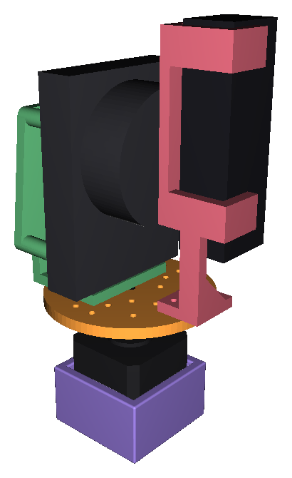
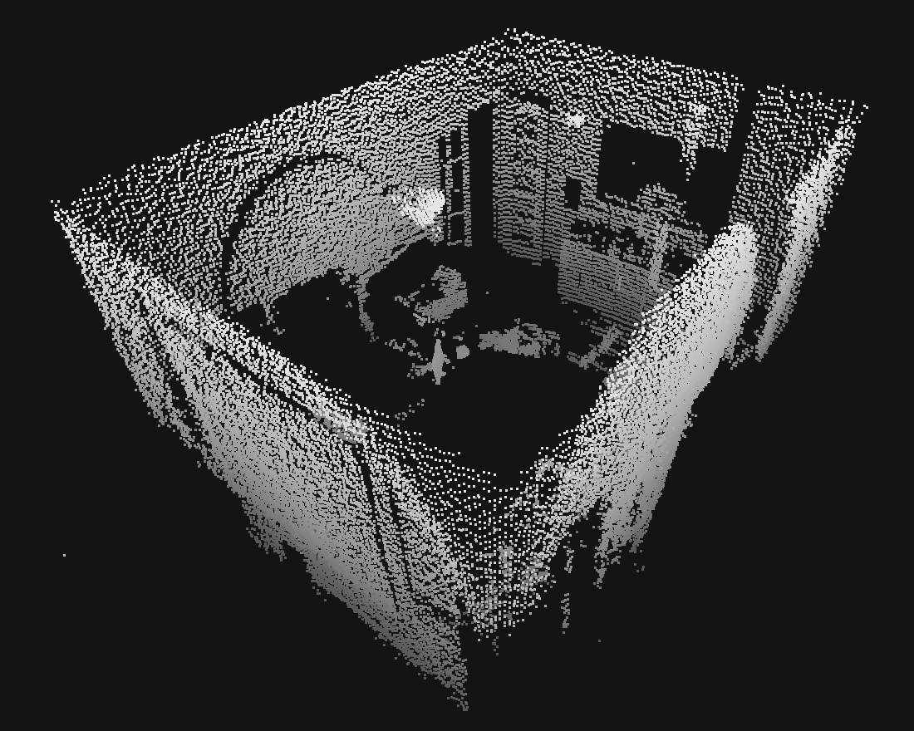
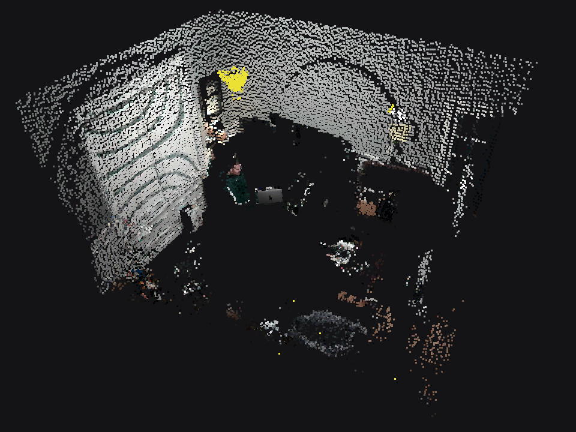

I've been fascinated by the "dollhouse" views commonly used on real estate listings. When I saw cheap 2D lidar scanners from robot vacuums for sale as surplus, I decided to build my own 3D scanner. This is part one of a series on building a 3D interior scanner from a 2D lidar.

This post covers the first prototype, built over a few evenings in January. It's deliberately simple: a cheap lidar on a 3D-printed turntable, scanning a room one slice at a time. The resolution is low, but it was enough to scan real rooms, color them from a camera, and show what later versions would need to fix.

# The hardware
The mechanical side is four 3D-printed parts:

- a **tripod adapter**, a cradle that holds a NEMA 17 stepper on top of a tripod,
- a **turntable**, a disc on the stepper's shaft with a grid of mounting holes,
- a **lidar mount**, a plate with four standoffs for the lidar and a flange that stands it on its side, so its scan plane is vertical,
- and a **camera mount**, an arm that holds the camera alongside the lidar.


{.half}

The stepper is driven from an ESP32 through an ordinary STEP/DIR driver. The firmware is a small serial command interpreter: `ANGLE 42.5` moves to an absolute angle, `SPEED` sets the RPM, `HOME` zeroes the position, and every command ends with `OK` or `ERROR`. There's no homing switch, so 0° is wherever the platform was at power-up.

## The lidar: HLS-LFCD2
The lidar is an HLS-LFCD2, the unit sold as the LDS-01 on the TurtleBot3. It's cheap and well documented, and it's about as simple as a lidar protocol gets. You send `b` to start it and `e` to stop it. While it runs, it streams 42-byte frames at 230400 baud. Each frame starts with `0xFA`, then an index byte that says which six degrees it covers, then two bytes of motor speed, then six 6-byte readings, with a two-byte checksum at the end. The distance sits two bytes into each reading:

```python
base_angle = (frame[1] - 0xA0) * 6
for m in range(6):
    offset = 6 * (m + 1)
    distance = struct.unpack('<H', frame[offset:offset + 2])[0]  # mm
```

That's one reading per degree, 360 per revolution, at about 5 revolutions a second. A full slice is 60 frames.

# Scanning
The prototype scans with a step-and-settle loop, which is as direct as it sounds:

1. Move the platform to the next angle.
2. Wait a second for the vibration to settle.
3. Capture one full revolution from the lidar.
4. Rotate that slice into 3D by the platform angle and append it to the cloud.

Each lidar reading is an angle φ within the scan plane and a distance d. In the scan plane that's a 2D point, `(d·sin φ, d·cos φ)`, with the second coordinate pointing up. Turning the platform by θ rotates the scan plane about the vertical axis, so the up coordinate is unchanged and the horizontal one is swung around:

```python
x_2d = distance * np.sin(phi)
y_2d = distance * np.cos(phi)    # up

x = -x_2d * np.cos(theta)
y = y_2d
z = x_2d * np.sin(theta)
```

Because the lidar sees a full circle, half a turn of the platform would be enough to cover every direction. The camera only looks one way, though, so a scan turns the full 360° in 0.5° steps to let it see the whole room. With a one-second settle at every stop, that takes about fifteen minutes.

Each scan is saved as an ASCII PLY file, which opens directly in MeshLab or CloudCompare. I tested it at home, starting with my office and then the rest of the main floor.



That's the resolution this prototype works at. With one reading per degree from the lidar and half a degree between slices, walls, doorways, and large furniture are clear, but anything smaller is already breaking up.

# Color
A bare point cloud shows geometry but not much else. You can recognize a room, but not what's in it. To color it, I mounted a camera alongside the lidar and took a frame at every stop.

The coloring relies on the fact that the camera turns with the lidar. With the camera on its side, the center column of each frame is a vertical line of pixels looking in nearly the same direction as that slice. For each lidar point, its elevation angle as seen from the camera picks a row in that column:

```python
y_from_camera = y_3d - camera_vertical_offset
vertical_angle = np.degrees(np.arctan2(y_from_camera, horizontal_dist))
# vertical angle → pixel row, via the camera's vertical field of view
```

The camera's field of view is much narrower than the lidar's full circle, so only part of each slice gets real color. Everything outside it is painted a placeholder yellow. Getting the colors to land on the right points took a few rounds of hand-tuning. The camera's tilt and its height above the lidar each needed a correction.



# Stitching rooms together
One scan only sees what's in line of sight from one spot. To capture more than one room and reduce blind spots, I took several scans from different places and aligned them by hand in MeshLab, then merged them into one cloud. The image at the top of this post is the whole main floor, merged this way. But lining up each scan by eye was slow and never quite exact.





# What's next
This prototype answered the question it was built for. A surplus 2D lidar on a 3D-printed turntable can capture a recognizable, colored 3D room, and a few scans stitched together start to look like the dollhouse views I was after. It also showed how far this version was from that goal:

- **Resolution.** The HLS-LFCD2 takes one reading per degree, so at 3 meters neighboring points are about 5 cm apart. Walls and large furniture come through, but anything smaller turns into noise.
- **Speed.** Every stop waits a second for the platform to settle and keeps just one revolution of data. A single room takes about fifteen minutes.
- **Color.** One column of pixels per frame colors only part of each slice, and every alignment correction was a number tuned by eye.
- **Merging.** Aligning scans by hand doesn't scale past a few rooms.

The rest of the series works through those one at a time: a denser lidar and a scanner that sweeps continuously instead of stopping, coloring from full camera frames with a fitted calibration, and automatic registration and meshing of a whole house.
