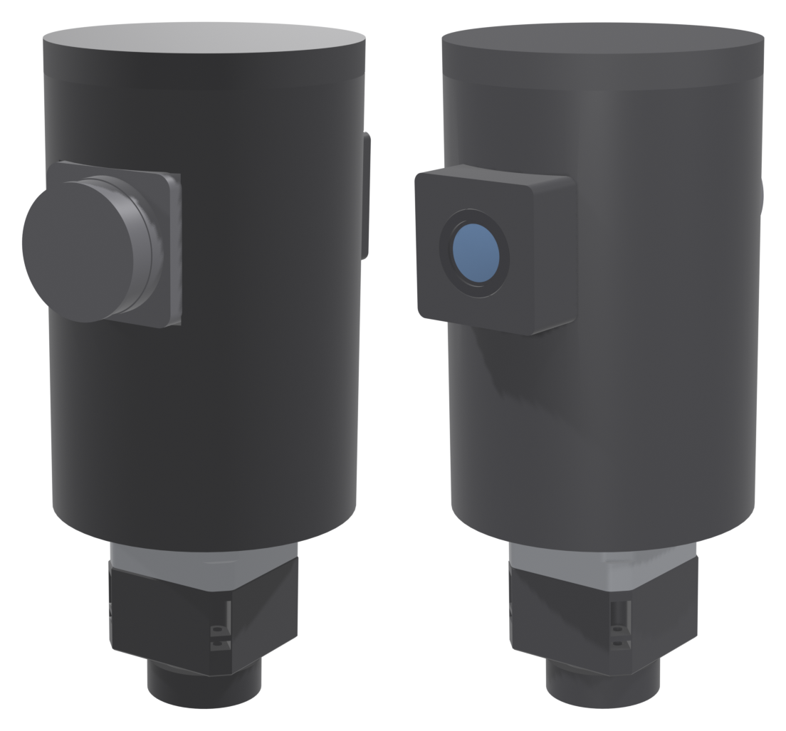
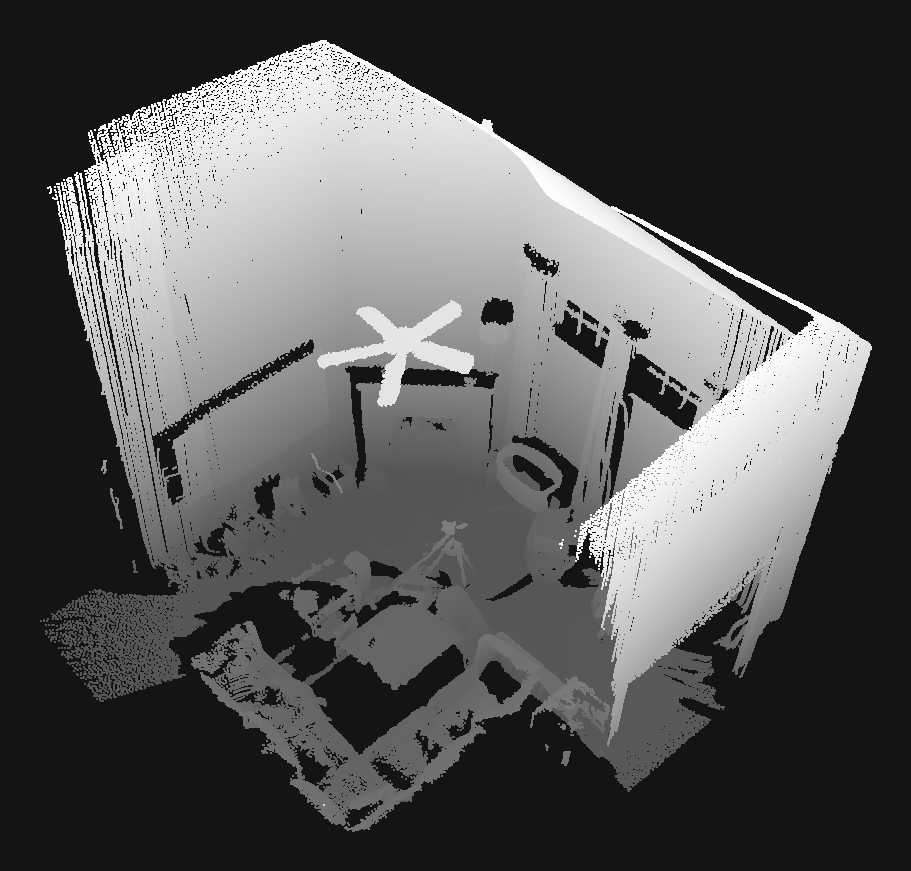
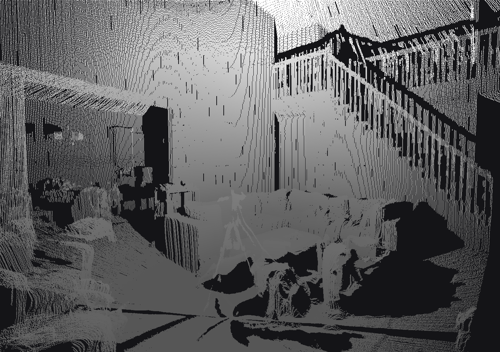

[Part one](../part-1-prototype/) ended with a list of problems, and resolution was first on it. The HLS-LFCD2 takes one reading per degree. Anything smaller than a chair broke up into noise. This post covers the fix: a denser lidar called the STL-27L, a new printed housing to carry it, and the first scans it produced. Every scan here comes from one spot and none are merged.

# The lidar: STL-27L
The STL-27L is a small time-of-flight lidar from LDROBOT. Like the HLS-LFCD2, it's sold for robot navigation. It's the same idea in a similar footprint, but a lot faster:

| | HLS-LFCD2 | STL-27L |
|---|---|---|
| Readings per second | 1,800 | 21,600 |
| Rotation rate | 5 Hz | 10 Hz |
| Angle between readings | 1° | 0.167° |
| Readings per revolution | 360 | 2,160 |
| Serial | 230400 baud | 921600 baud |

The datasheet claims ±15 mm accuracy out to 2 m and a range of up to 25 m on a white target. That's far more than any room needs.

The protocol is even simpler than the HLS-LFCD2's. There's nothing to send. Once the motor is up to speed, the lidar starts streaming 47-byte packets on its own. Each packet starts with `0x54 0x2C` and gives the motor speed and a start angle. Next come twelve readings of three bytes each: a 16-bit distance in millimeters and an 8-bit intensity. An end angle, a timestamp and a CRC-8 close the packet. The twelve readings are spread evenly between the start and end angles:

```python
start_angle = struct.unpack_from('<H', data, 4)[0] / 100.0   # hundredths of a degree
end_angle = struct.unpack_from('<H', data, 42)[0] / 100.0
step = ((end_angle - start_angle) % 360.0) / 11

for i in range(12):
    offset = 6 + i * 3
    distance = struct.unpack_from('<H', data, offset)[0]     # mm
    intensity = data[offset + 2]
    angle = (start_angle + step * i) % 360.0
```

That's about 1,800 packets a second. A background thread reads them into a buffer as they arrive. At each stop, the scan takes one revolution's worth from the buffer, which is 180 packets.

The scan software also moved off my Mac and onto a Raspberry Pi. The Pi reads the lidar on one of its UARTs and talks to the ESP32 driving the stepper on another.

Here's what the extra density looks like in a single slice. Each plot is a vertical cut through a room from floor to ceiling, taken by one lidar at one platform angle. The STL-27L's points are denser, and they also scatter much less. Its wall is a straight line where the HLS-LFCD2's wanders by a few centimeters:


# A housing
The part one prototype was a turntable with a lidar and a camera bolted to it. For the STL-27L I designed a housing in FreeCAD that turns the whole sensor head as one piece. The motor turns with it.



The stack is upside down compared to the turntable. From the bottom up:

- a **tripod puck** that the tripod screw threads into,
- a **printed planetary gearbox**, whose output is bolted to the puck,
- the **NEMA 17 stepper**, shaft down into the gearbox,
- a **stepper mount**, an 85 mm cylinder with a pocket that encloses the back of the motor body,
- the **main housing**, an 85 mm cylinder screwed to the stepper mount,
- and a **lid** that closes the top of the housing.

The tripod holds the gearbox's output still. When the motor runs, the motor body itself turns and carries the mount and the housing around. Everything above the puck turns together. Nothing has to bridge a fixed base and a turning platform.

The gearbox is 3.7:1. At 8 microsteps, one turn of the housing is 5,920 steps, or about 0.06° per step.

# First scans
The first serious scan was of the living room. I ran it the same night I wrote the STL-27L driver. It used 0.25° per stop and turned the platform only 180°. Each slice kept the lidar's full circle instead of half of it. Half a turn of full circles covers every direction once. The scan has no color. Its 721 stops took about 13 minutes and produced about 1.56 million points.



The living room is two stories tall. Its far walls are about 4 m from where the scanner stood. At 0.25° steps, neighboring slices there are under 2 cm apart. From inside, the stair railing comes through baluster by baluster:



On January 28 the camera was mounted, and I scanned my office several times. The first scans used 1° steps and the later ones 0.25°. Both used the full 360° turn the camera needs. A 1° scan has about 392,000 points and a 0.25° scan about 1.57 million.



Compare this with part one's office. Here's an eye-level view of the same room from each lidar. The HLS-LFCD2 scan was taken on January 11 and lined up with the new one:


The TV, the white shelf under it, the panes in the French doors and the light fixture are all recognizable now. The colors mostly land on the right surfaces.

# What's next
The STL-27L fixed the resolution problem. Each slice has six times as many points. A 0.25° scan is dense enough to pick out a stair railing. A few problems remain:

- **The body.** The next hardware revision puts the lidar, camera, Raspberry Pi and a battery all on one turning hub.
- **Speed.** Point density between slices is still limited by how many stops a scan can afford. Every stop costs its settle time. The answer is a continuous sweep. The platform turns at constant speed while the lidar streams, and every point is placed using the platform's angle at the instant it was measured.
- **Color.** Coloring needs to use the whole camera frame with a real camera model. A single column of pixels and hand-tuned offsets aren't enough.
- **Merging.** These are still single scans. Combining several scans into a whole floor is still to come.
