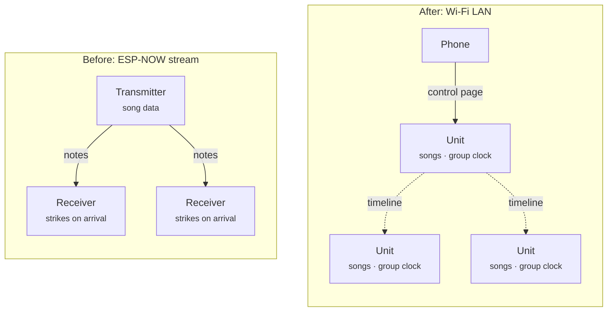
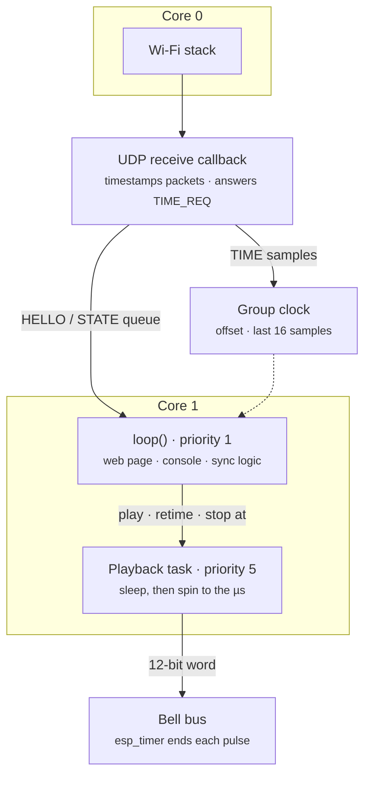
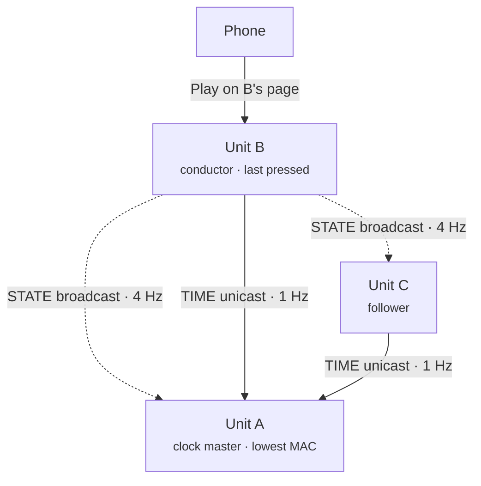
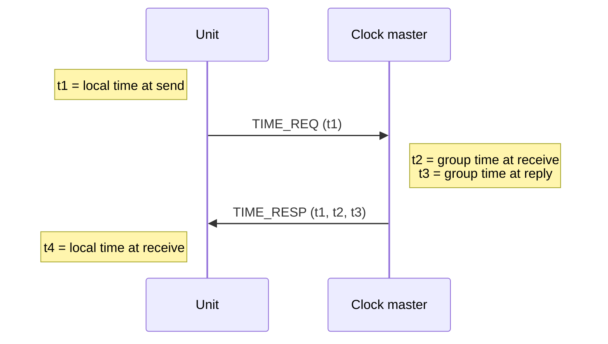
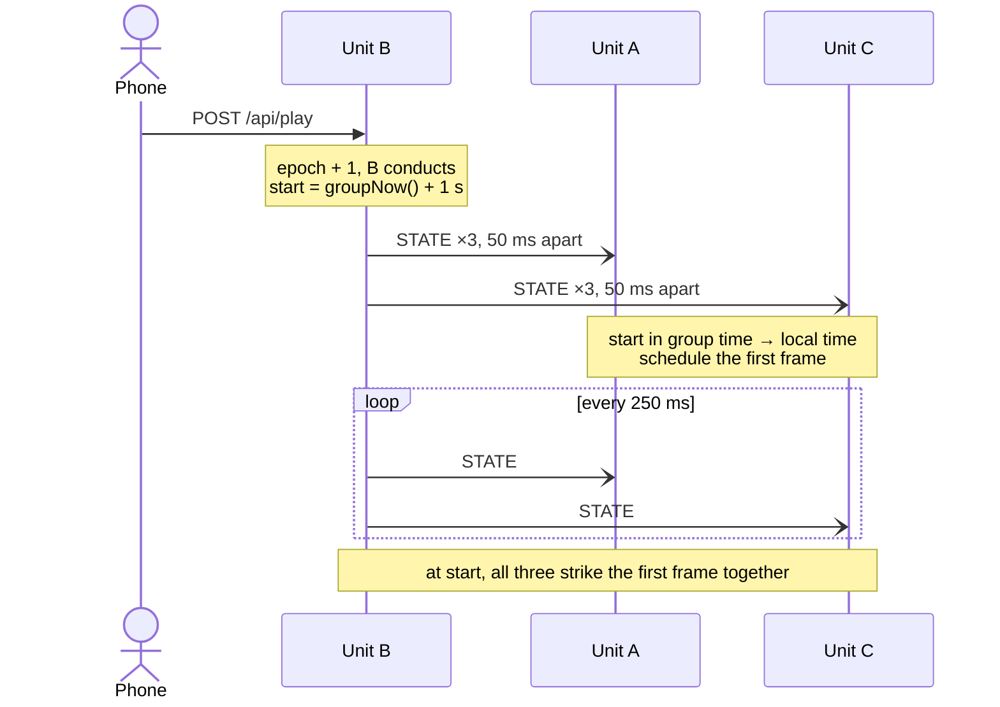

<!-- TODO: video of several units playing together off one press on a phone. -->

In [part one](../part-1-ojb-module/), one ESP32 acted as a transmitter and streamed notes over ESP-NOW. The receivers in the bell units struck each note the moment it arrived. That got a choir playing, but the design had limits. Everything depended on one transmitter and the reach of its antenna. A dropped packet was a missed note. The receivers couldn't do anything on their own.

The new firmware turns that around. Every unit now carries the whole song library and plays it itself. The network doesn't carry notes anymore. It only carries agreement on *what* to play and *when*. The source is in [`firmware/`](https://github.com/mtlevine0/open-jingle-bells/tree/main/firmware) on GitHub.



# Why UDP instead of ESP-NOW
The units already needed Wi-Fi for a control page, so I moved sync onto the same network as plain UDP. That brings three benefits:

- **Coverage.** Range becomes the router's coverage, mesh nodes included, instead of one unit's antenna.
- **No channel juggling.** ESP-NOW and a Wi-Fi connection have to share one radio channel. On the LAN every unit just uses the network's channel.
- **Tooling.** A laptop on the same network can watch and send sync packets with ordinary UDP tools.

It costs two things. Each unit now needs a router and Wi-Fi credentials, and a unit off the network plays alone. Wi-Fi broadcast timing is also unreliable. Broadcast frames get no acknowledgment or retry. If any station on the network is in power save, the access point holds broadcasts until the next DTIM beacon, which can be a few hundred milliseconds away. Most of the design below exists to work around those two facts.

# Inside one unit
Before any syncing, each unit has to play a song on time by itself. The songs come from the original ROM cartridge dump. A build script turns the 26 songs into a generated header, about 17 KB of 12-bit frames, one bit per bell. Each song has a fixed step time, and frame *n* is due at `start + n × step`. A CRC over the whole library lets units confirm they all carry the same songs.

The trap on an ESP32 is `loop()`. The web server, DNS for the captive portal and Wi-Fi reconnects can each hold it for tens of milliseconds, which is far too long for music. So nothing time-critical runs there:



The playback task is pinned to core 1 at a higher priority than `loop()`. It sleeps until about 2 ms before a frame is due, then busy-waits to the exact microsecond and writes the 12-bit word to the bell lines. A one-shot `esp_timer` ends the strike pulse, and the task never waits for it. If the task finds itself more than 50 ms behind, it jumps to the frame that's due now instead of firing a burst of stale strikes. That same rule handles a unit joining in the middle of a song. A counter tracks strikes that fire more than 2 ms late, and the Health page shows it.

The UDP receive callback runs in the network stack's task, not in `loop()`. It reads the timer the moment a packet arrives and answers clock requests on the spot. Everything else goes into a queue for `loop()` to handle when it gets there.

# Two roles: clock master and conductor
A group of units needs two things: a shared sense of time, and someone deciding what to play. I split those into two roles so that changing who's in charge never disturbs the clock.

- **Clock master.** The unit whose clock defines *group time*. It's the synced unit with the lowest MAC address. It only changes when that unit leaves or a lower MAC joins.
- **Conductor.** Whichever unit took the last command. Press Play on any unit's page, its button or its serial console, and that unit becomes the conductor.



All of this traffic passes through the router. It's drawn as direct links to show who talks to whom. One unit can hold both roles, and in a group of one it holds both.

The units speak three kinds of packet on UDP port 47800. Each starts with a magic number, a protocol version, a group number and the sender's MAC. The group number is a setting, so two choirs can share a network without hearing each other.

| Packet | Sent by | Delivery | Rate | Carries |
|---|---|---|---|---|
| HELLO | every unit | broadcast | every 2 s ± 200 ms | name, firmware, library CRC, synced or not, round trip, jitter, late strikes, RSSI |
| STATE | the conductor | broadcast | 4 Hz, plus 3 quick copies on a change | the song timeline, in group time |
| TIME | each unit ↔ the master | unicast | 1 Hz, plus a burst of 8 on joining | timestamps for the clock |

HELLO is how units find each other. Each unit keeps a peer table from them and drops a peer that's been quiet for 6 s. The table also feeds the group card on the Health page.

# The group clock
Every unit keeps one number, an offset from its own microsecond timer:

```
groupNow() = esp_timer_get_time() + offset
```

The master serves group time and never changes its own offset. Everyone else estimates theirs with an exchange borrowed from NTP:



From the four timestamps the unit gets a round trip and an offset estimate:

```cpp
int64_t rtt = (t4 - t1) - (t3 - t2);
Sample s = {((t2 - t1) + (t3 - t4)) / 2, (int32_t)rtt};
```

The offset formula assumes the request and the reply took equally long. On Wi-Fi they often don't. One leg might wait behind a retry or a busy channel. But the exchanges with the shortest round trip are the ones where neither leg waited, so they're also the most symmetric. The unit keeps its last 16 samples and trusts the one with the smallest round trip. Samples within 3× that round trip count as good, and the spread of their offsets is reported as jitter. After 4 good samples the unit counts itself synced. An unsynced unit doesn't play.

The filter earns its keep. A probe from my laptop to a clock master measured a best round trip of 3.0 ms, and the master turned requests around in 22–49 µs. Occasional exchanges took up to 565 ms. An average would have been wrecked by those. The minimum-round-trip filter just ignores them.

When the estimate moves, the offset has to follow without upsetting a song in progress:

- **Step.** While converging, or for a change over 20 ms, the offset jumps straight to the estimate. Playback lands on whatever frame is due.
- **Slew.** Smaller changes are fed in at up to 0.5 ms per second. Each correction also shifts the playback timeline by the same amount in the other direction. Frames fall due slightly earlier or later, but none are doubled or skipped.

Because the master never adjusts its own offset, group time stays continuous when mastership moves. If the master is unplugged, the next-lowest synced MAC takes over with the offset it already had. The others clear their samples and start measuring against the new master. Their offsets don't reset, so group time doesn't jump.

Electing the first master takes one extra rule. The master is the lowest MAC among *synced* units, but a freshly booted group has none. In that case each unit listens for 3 s, and the lowest MAC it has heard claims the role. Units that boot together all reach the same answer.

# The conductor
Pressing Play makes a unit the conductor. It doesn't send notes. It sends a description of the song timeline, called STATE:

```cpp
uint32_t epoch;         // conductor term
uint32_t seq;
uint32_t libraryCrc;
uint8_t  playing;
uint8_t  song;
uint8_t  mode;          // once, repeat or play all
int64_t  startGroupUs;  // group time of the song's first frame
int64_t  stopGroupUs;   // group time a stop takes effect
```

The key field is `startGroupUs`. Play doesn't mean "start now". It means "start 1 s from now, in group time". That second covers the DTIM delay and anything else Wi-Fi does to a broadcast. As long as any copy of STATE arrives before the start time, every unit strikes the first frame at the same instant. Stop works the same way with a 300 ms lead. A unit with no peers skips most of the wait and starts after 150 ms.



STATE is idempotent. Each copy describes the whole timeline. A unit that misses some copies still gets everything it needs from any other. Followers don't just obey each packet as it lands. Whenever a new STATE arrives, and every 250 ms in between, each one reconciles:

1. Project the timeline forward to now. In repeat and play-all, songs advance with a 1.5 s gap between them. Every unit has the same library, so they all compute the same next song and start time without being told.
2. Convert the start from group time to local time, applying this unit's strike offset.
3. If local playback already matches within 3 ms, do nothing. Otherwise restart it on that timeline.

A unit that powers up mid-song does exactly the same thing. It hears STATE, projects to the current frame and joins in.

Two units can be pressed at nearly the same time. The `epoch` settles it. Taking the baton sets the epoch to one more than the highest seen, from STATE or from anyone's HELLO. The highest epoch wins. On a tie, the lower MAC wins. A conductor that hears a winning STATE from someone else steps down and follows.

Two safety checks round it out. A unit whose library CRC differs from the conductor's stays silent and shows a mismatch instead of playing the wrong notes. And each unit has a strike offset setting from −100 to +100 ms, to trim out mechanical differences between bell units.

# Watching it work
Every unit serves the same control page at `<name>.local`. The Play tab controls the whole group, and pressing Play there makes that unit the conductor. The Health tab shows the group as this unit sees it.


Here the unit I'm browsing has the lowest MAC, and the last command came from its page, so it holds both roles. Its own row has no round trip or jitter because the master doesn't measure against anyone. The second unit's row shows its best round trip to the master, 4.34 ms, and 2.02 ms of spread between its good offset samples. It also counted one strike that fired more than 2 ms late.

Over USB serial, `sync` prints the roles, the clock and the peer table. `drop 80` makes a unit throw away 80% of the sync packets it receives, to test the redundancy. On a laptop, `ojb-sync-monitor` decodes the HELLO and STATE broadcasts, and `--time` measures the round trip to the master.

# What's next
The units sync and play together on real hardware, but I haven't measured how closely yet. The target is under 2 ms of skew between units, checked with a logic analyzer on the same bell line of two boards. I also want to repeat the test with a power-saving phone on the network, with packet drop turned up, and with the master unplugged mid-song.

There's one known gap. If the conductor disappears, the others carry on with the timeline they last heard. A unit that joins after that never hears STATE and stays idle. The fix is a takeover: after 3 s without STATE, the lowest synced MAC picks up the same timeline with a higher epoch and carries on. Firmware updates over the network and a password for the settings pages are also on the list.

In the next post, the bells get new songs without a laptop. Every unit now serves a composer: tap out a tune on a phone, press Play, and the whole group fetches it and plays along.
