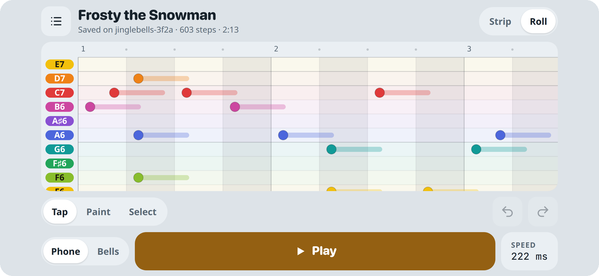
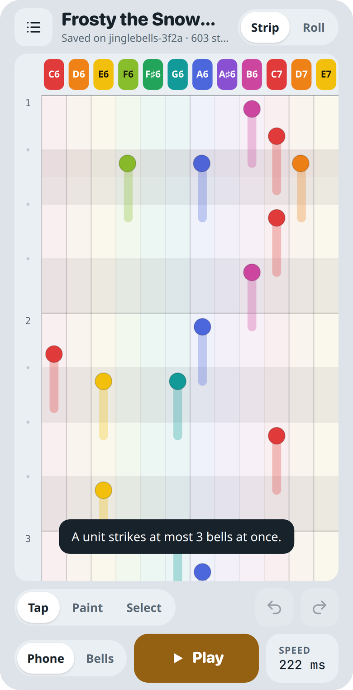
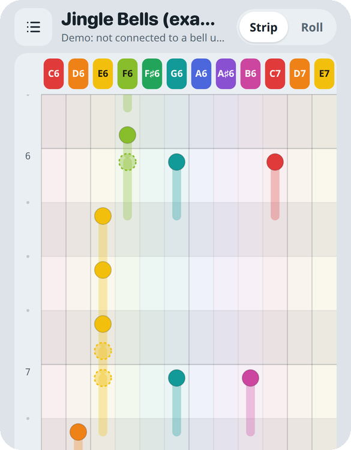
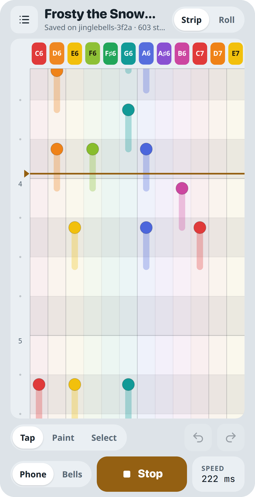
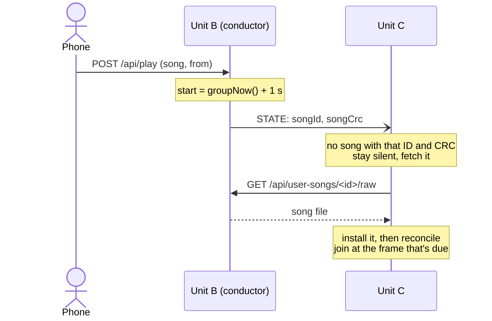

<!-- TODO: photo or short video of someone composing on a phone next to a set of bells. -->

Until now every song the bells could play came from somewhere else. The 26 originals are from the ROM cartridge dump. New arrangements went through a pile of Python on my laptop, which turns a MIDI file into a generated header, and then every unit had to be reflashed. That's fine for me. It's useless for anyone else at the party who wants to try a tune.

So every unit now serves a composer at `<name>.local/compose`. Open it on a phone, tap out a song, and press Play. The song saves to the unit as you go, and the rest of the group fetches a copy and plays along. The source is [`firmware/composer_ui.h`](https://github.com/mtlevine0/open-jingle-bells/blob/composer/firmware/composer_ui.h) on GitHub. <!-- TODO: point at main once the composer branch merges. -->

# Try it
This is the composer itself, the same page the firmware serves. Here it can't find a unit, so it runs as a demo. It opens with the start of Jingle Bells and saves nothing. Play uses your device's speaker with a synthesized bell. Tap a square to add a bell, and long-press a step for more options.



The page is a single 50 KB file with no external requests. Everything is inline: styles, script and icons. The units are often on a network with no internet, and the control page from [part two](../part-2-conductors-and-clocks/) already works the same way.

# A music-box strip
A song on these bells is a list of 12-bit words, one per step, and each set bit strikes one bell. That's already a grid, so the composer just draws it as one. It looks like the paper strip of a music box. Each bell gets a lane, and time runs down the screen. One square is one step, and one tap toggles one bit.


A few details make the grid readable at a glance:

- **Pitch order.** The lanes run low to high, C6 to E7. The ROM's bit order is scrambled, so the page keeps its own words in pitch order and converts them on the way to the unit.
- **Colors by note name.** Both Cs are red, both Ds orange and both Es yellow. The same note in the other octave is easy to spot.
- **Gaps in the scale.** The bells have no C♯6, D♯6 or G♯6. A heavier line between two lanes marks where a semitone is missing.
- **Beats and bars.** Two steps make a beat and eight make a bar, so a step is an eighth note in 4/4. Alternate beats are shaded, and bar numbers run down the left edge.

In landscape, the Roll layout draws the same grid like a piano roll, with time running across:



The bell chips at the top double as a keyboard. Tap one to hear that bell, and it glows when the song strikes it.

# Built around what the bells taught us
The arranging tools taught me two hard rules, and the composer is built so you can see them.

**At most three bells at once.** A unit strikes no more than three bells in one step. Tapping a fourth bell on a full step doesn't add it. The step shakes, the phone buzzes and a toast explains why. The firmware checks this again when it saves.

{.compact}

**Don't strike a bell that's still ringing.** In [the microphone tests](https://github.com/mtlevine0/open-jingle-bells/blob/composer/docs/composing.md), a bell struck again within about 400 ms barely sounded, and sometimes the striker choked it. So every strike draws a faded trail down its lane for 400 ms. At 250 ms a step, that's two squares. A strike that lands inside its own bell's trail turns hollow with a dashed outline. It still plays, but the hollow strike warns that it will sound weak.



The first time the page opens, a hint explains the trails. That's the one thing a newcomer wouldn't guess.

# Editing with a thumb
The composer is phone-first, so every control sits at the bottom of the screen within thumb reach. Three touch modes cover the different jobs:

- **Tap.** Tap a square to add or remove a bell, and drag to scroll. This is the default.
- **Paint.** Drag across squares to paint bells in, or out if the first square was already set. Two fingers scroll.
- **Select.** Drag across steps to select them. A bar appears to duplicate, clear or remove the selection. Duplicate is the quickest way to repeat a verse or a chorus.

A long press on any step opens a menu for that step. It shows the bar and beat, the time into the song and the raw ROM word. It can play from that step, insert an empty step before it, clear it or remove it. Tapping in the step gutter on the left plays from that step straight away.


Speed is set as milliseconds per step, since that's what the unit stores. The sheet also shows it as BPM. Frosty's 222 ms steps work out to 135 BPM. Undo and redo keep the last 200 edits.

# Hearing it on the phone
With the output set to Phone, Play previews the song through the phone's speaker with Web Audio. Each strike is a sine at the bell's pitch plus two quieter partials that decay faster. The ratios aren't whole numbers, which is what makes a struck bell sound like a bell rather than an organ:

```js
// fundamental plus two inharmonic partials, like a small struck bell
for (const [mul, amp, dec] of [[1, 1, 1.5], [2.76, .26, .45], [5.4, .09, .2]]) {
```

The pitches are the ones measured from the real bells during calibration, not the nominal note frequencies. Every real bell is 5–60 cents sharp, so the preview is too. Strikes are scheduled a little ahead on the audio clock, so they stay in time even when the page is busy drawing.

{.compact}

Getting sound out of a phone took more work than making it. Phones only allow audio to start inside a tap, and specifically on touchend or click, not pointerdown. On top of that, iOS mutes Web Audio when the ring/silent switch is set to silent. The workaround is to also loop a silent WAV through an `<audio>` element. That makes iOS treat the page as media playback, and the bells come through even with the phone on silent.

# Saving on the unit
On a unit, there's no save button. The page sends the song 700 ms after the last edit, one request at a time, and again if the page is hidden. The line under the title shows where the song lives: "Saved on jinglebells-3f2a · 603 steps · 2:13".

The unit stores each song as a small file on LittleFS, `/songs/<id>.bin`. Each file holds a header with the name, step time and an ID, followed by the ROM words. A write goes to a temporary file first and is then renamed over the old one, so a power cut mid-save leaves the previous version intact. Composed songs join the song table after the 26 built-in ones, so the control page lists and plays them like any other song.

The limits come from RAM. Composed songs are held in memory so the playback task never waits on flash:

| Limit | Value |
|---|---|
| Songs | 32 |
| Steps per song | 4,000, about 13 minutes at 200 ms |
| Steps across all songs | 24,000, 48 KB of RAM |
| Step time | 50–2,000 ms |
| Bells per step | 3 |

The composer talks to the unit over a small REST API:

| Method | Path | Does |
|---|---|---|
| GET | `/compose` | The composer page |
| POST | `/api/user-songs` | Create a song: `name`, `step_ms`, `frames` as comma-separated hex ROM words |
| GET / POST / DELETE | `/api/user-songs/<id>` | Read, update or delete one song |
| GET | `/api/user-songs/<id>/raw` | The song file as stored, for peers |
| POST | `/api/play` | Now takes `from`, the first step to strike |

The My songs sheet lists what's on the unit, with copy and delete. Delete asks for a second tap before it goes through.


# Playing on the bells with the group
Switch the output to Bells and Play plays the song on the real bells, with every unit in the group. This is where the sync design from [part two](../part-2-conductors-and-clocks/) needed a change.

The conductor's STATE packet used to name a song by its number. That works for the built-in songs, because every unit has the same library in the same order. Composed songs break that. A song saved on one unit doesn't exist on the others, and if it did, it could have a different number. So the sync protocol moves to version 2, and STATE gains three fields:

```cpp
uint32_t songId;      // composed song, or 0 for compiled-in song number `song`
uint32_t songCrc;     // composed song's contents
uint16_t firstFrame;  // where the first song starts (play from a step)
```

A follower looks the song up by ID and checks the CRC. If it doesn't have the song, or has an older version, it stays silent and fetches the file from the conductor:



The download runs in its own background task, so `loop()` keeps serving the web page and sync while it waits. A failed fetch is retried after 2 s. If the song arrives within the 1 s lead-in, the follower strikes the first frame with everyone else. If it arrives later, the same rule that lets a unit join mid-song applies, and the follower comes in on the frame that's due. The fetched song stays in the follower's library afterwards.

<!-- TODO: measure how long a 600-step fetch takes and whether it lands inside the 1 s lead-in. -->

Playing from a step needed one more trick. The playback task works out every frame's time as `start + n × step`, and I didn't want to change that. So when you play from step 40, the conductor moves the song's start back by 40 steps in group time and tells playback to skip frames before step 40. Every unit does the same frame math as before, and the song simply starts partway through. Repeats and the next song start from the top again.

While the bells play, the composer's playhead follows them. It polls `/api/status` four times a second for the frame the unit will strike next, and runs the playhead on from there between polls. The bell chips glow as each step is struck.

Protocol 2 means every unit has to be updated together. Units drop sync packets from any other protocol version, so a unit on the old firmware and one on the new can't see each other at all.

# What's next
The composer works on hardware, but I haven't timed the song fetch across a big group yet. I want to know how long a long song takes to reach every unit, and whether a fetch storm of a dozen units at once slows the conductor down.

<!-- TODO: more next steps. Ideas: importing a MIDI or one of the generated headers into the composer, sharing a song between units without playing it, moving trails to per-bell gaps once the calibration data supports it. -->
