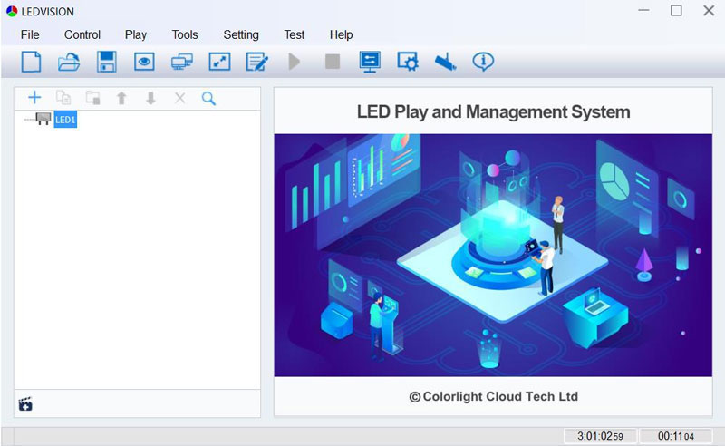
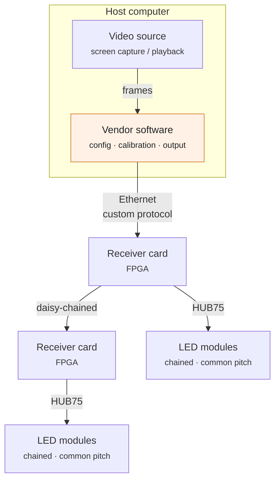
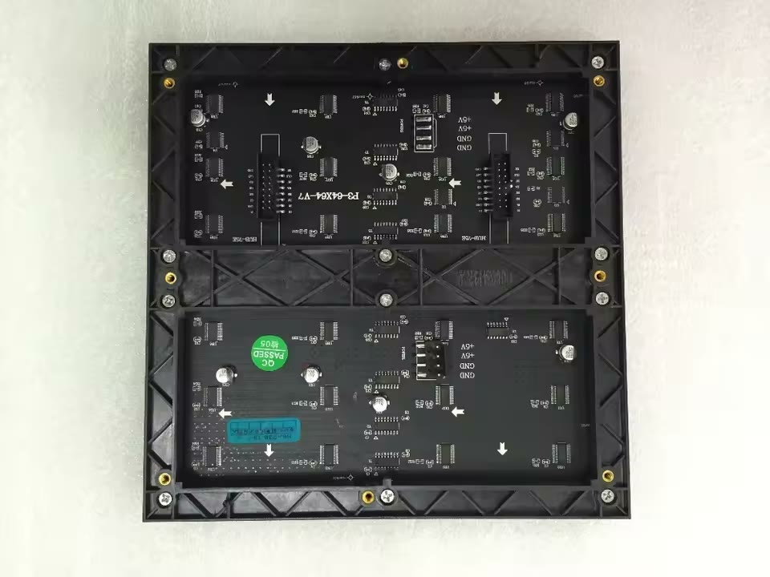
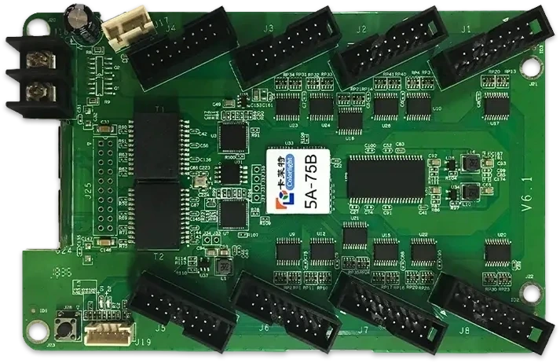
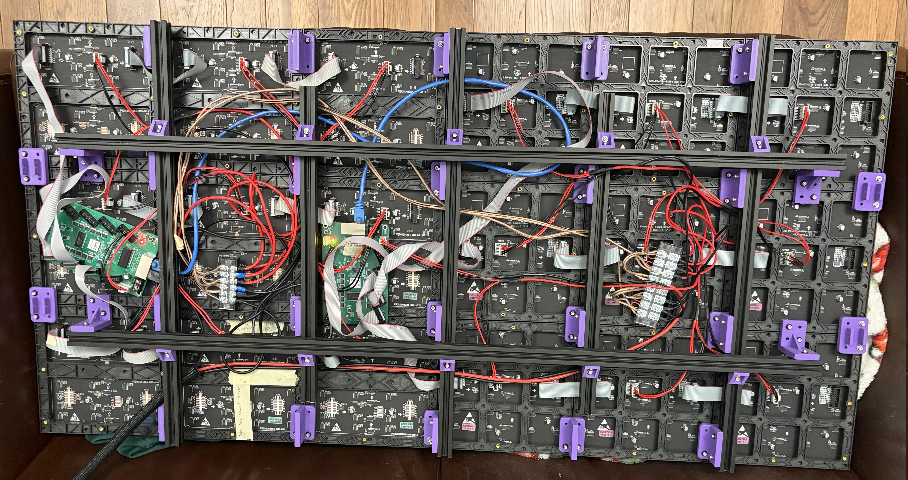
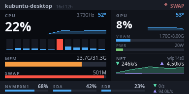
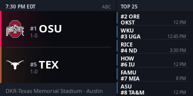
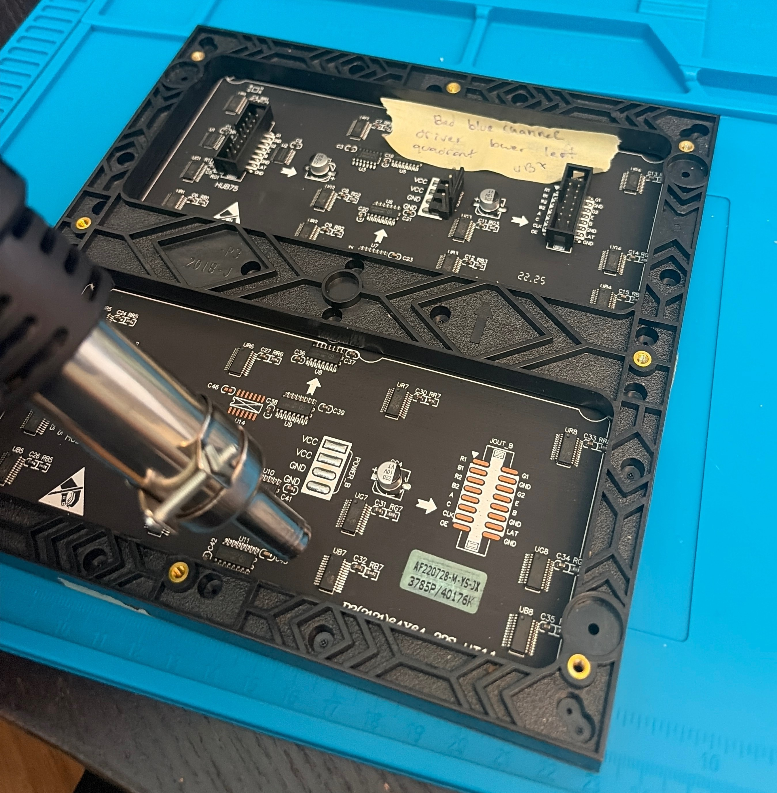

This is part one of a series that details my journey building an open-source video wall. The overall goal is to build an open-source software stack for driving video walls built from commodity hardware. This first part covers the driver: reverse-engineering the vendor's video protocol and replacing the part of the vendor software that streams video to the wall with an open alternative that can put any video stream on it. Configuration and calibration still go through the vendor software for now; those are left for a later part.

# Background
### How it's done commercially
Most of the major components used in commercial video walls are already commodity products available cheap at low volumes. The LED modules leverage one of a few common hardware buses and pixel pitch conventions. Receiver cards interface with a video source and one or more LED modules via the module's bus. Vendor software talks to the receiver cards over Ethernet using very simple custom protocols. The modules and receiver cards are interchangeable; the vendor software is the only piece you're locked into, and it's the piece this series replaces.

### The vendor software
The Colorlight receiver cards used in this build are meant to be driven by proprietary vendor software called LEDVISION, which handles three jobs: configuring them to match the cabinet's specifications, calibrating brightness and chroma on a per-pixel basis, and capturing content on the host computer and delivering it to the display. This post replaces the third job; the first two stay in LEDVISION for now.


{.half}

That lock-in is the problem. LEDVISION is Windows-only, built around capturing a desktop screen, and carries no guarantee of support a month from now, let alone years from now. I wanted a wall I could drive headless from a Linux box, with content generated by code instead of screen-captured from a desktop.



# Hardware
### The LED modules and the receiver card
These modules use the HUB75 hardware bus. HUB75 is a dumb parallel interface: no framebuffer or timing controller of its own, just rows of shift registers that need to be fed continuously by something upstream. Its simplicity makes it very versatile; people often drive small 128×64 displays with lower-power devices like the ESP32.


{.half}

That continuous feeding is the job of the receiver card, in this case a Colorlight 5A-75B. It sits between a host sourcing a video frame stream and the HUB75 LED modules. It's a small board built around a Lattice ECP5 FPGA, with two gigabit Ethernet ports (one in, one out for daisy-chaining cards) and eight HUB75 output headers. The host only has to send each frame once over Ethernet. The FPGA buffers it and handles the fast, repetitive work of scanning rows and modulating brightness on the modules. The card also stores its configuration (module size, scan type, chain layout) and calibration data in onboard flash, so those settings survive power cycles and don't need to be resent with every frame.


{.half}

### Frame and power
The display itself consists of eighteen 64×64 HUB75 "P3" LED modules, wired as three parallel chains of six for a combined 384×192 resolution, split across two receiver cards. I designed a series of 3D-printed brackets mounted to 2020 aluminum extrusions to build what's referred to commercially as a cabinet.



Power comes from a single 200W Mean Well 5V supply, delivered to two bus bars that distribute it out to all eighteen LED modules and both receiver cards.

# Reverse-engineering the protocol
### Talking to the receiver card
I used Claude to help build a portable, open-source alternative to LEDVISION: [colorlightpy](https://github.com/mtlevine0/colorlightpy). Using Wireshark, I captured a video stream sent from LEDVISION to the Colorlight receivers and asked Claude to reverse-engineer the protocol.

The 5A-75B doesn't speak IP. It listens for raw Ethernet Layer 2 frames on whatever link it's plugged into, addressed to a fixed destination MAC (`11:22:33:44:55:66`) that has nothing to do with the card's actual hardware address. There's no ARP or handshake, and no acknowledgment. You send frames, and if the EtherType and payload layout are exactly right, pixels change. If they're not, nothing happens and there's no error to read back. That absence of feedback made the whole process slow: every hypothesis about the protocol had to be tested by watching the display.

The protocol that fell out of that process, per row of the display:

- **Row data**: EtherType `0x5500 | (row >> 8)` encodes the row's high byte right into the EtherType field, with the low byte, a column offset, a pixel count, and a 2-byte magic value (`0x0888`, purpose still unknown, just required) in the payload ahead of the packed RGB bytes.
- **Brightness**: EtherType `0x0A00 + brightness`, no payload needed; the value is encoded directly in the EtherType.
- **Sync**: EtherType `0x0107`, sent once per frame after all the row data, latches the whole pixel buffer to the display atomically so you never see a frame torn mid-scan.

A standard Ethernet MTU caps a single frame at about 493 pixels' worth of RGB data, so a 384-pixel-wide row fits in one packet but a wider chain has to be split across several packets, each with its own column offset, since the card won't do it for you.

# Implementation
### Building frames
[`protocol.py`](https://github.com/mtlevine0/colorlightpy/blob/master/colorlight/protocol.py) builds the raw frame bytes with `struct.pack` and nothing else, specifically so it can be unit-tested and profiled without a live NIC or root privileges. The send path uses `scapy` for the raw L2 socket itself, which does need root (or `CAP_NET_RAW`) because it writes directly to the network device below the IP layer.

### Streaming architecture

`colorlightpy` has a couple of built-in test-pattern generators, useful for confirming the display is wired up correctly before trusting it with anything real. But the mode that actually matters is `stream`: read raw RGB bytes from stdin (or a named pipe) and push them to the display as fast as they arrive.

```bash
python main.py stream -i eth0 -W 384 -H 192 --fps 30 --pixel-format bgr
```

That's the entire interface. Feed it `width * height * 3` bytes per frame (no header or framing, just raw pixels) and it drives the display. It doesn't care what produced those bytes. `ffmpeg` decoding a video file into `rawvideo` works:

```bash
ffmpeg -re -stream_loop -1 -i video.mp4 -f rawvideo -pix_fmt rgb24 -vf scale=384:192 - \
  | python main.py stream -i eth0 -W 384 -H 192
```

# Where this leaves off
At this point `colorlightpy` handles the job that matters day to day: it takes any well-formed stream of raw RGB frames and puts it on the wall reliably. The other two LEDVISION jobs aren't covered yet. Configuring the cards for the cabinet and calibrating the display still took one session in LEDVISION. The cards store both, so it hasn't been needed since, but it's the last piece of the stack that isn't open.

It's also where one hardware limitation lives. The wall's three chains are split across two receiver cards, even though a single 5A-75B has more than enough HUB75 outputs and the hardware is capable of driving the full 384×192 on its own. LEDVISION doesn't seem to offer a configuration that maps the whole cabinet onto one card. Closing that gap is one of the reasons I want to reverse-engineer LEDVISION's configuration side too, not just its video output, which makes it the obvious candidate for a later part.

A driver is necessary but not sufficient for a wall you'd actually want to look at day to day. That's where [GRID](https://github.com/mtlevine0/grid) comes in: the next layer up, an orchestrator that runs a handful of independent widgets (scoreboard, system monitor, weather, now-playing, NVR alerts), each as its own subprocess speaking `colorlightpy`'s exact frame contract, and a physical macro pad to switch between them. Two frames actually captured off the running wall, ahead of the full writeup:




More on how that's built in the next post.

# Appendix
### Hot-air rework

One of the modules turned out to have a bad blue-channel driver IC in one quadrant, a failure that's easy to diagnose (a dead color channel, localized to one block of pixels) and looks intimidating to fix if you've never done surface-mount rework before. It was a good excuse to try hot-air rework. The process is a lot more approachable than it looks, and the hobbyist-level tooling (a decent hot-air station, some flux, solder paste) is cheap enough that there's no real excuse not to have it on hand.


