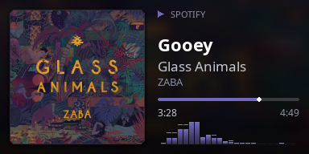
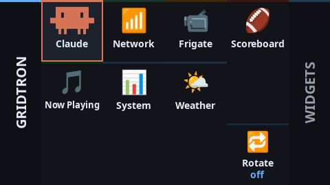
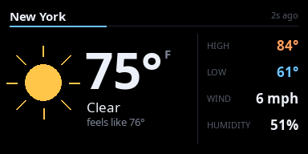
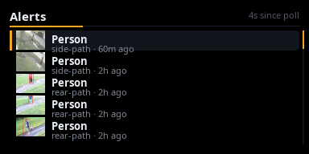
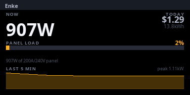
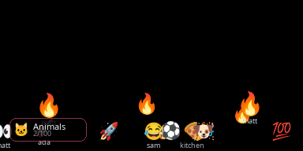

{.pixelated}

[Part one]() of this series covered `colorlightpy`: a driver that will take any well-formed stream of raw RGB frames and put it reliably on a wall-mounted 384×192 LED display. That's necessary, but it says nothing about *what* to show, or how to switch between things without SSHing in and restarting a process. This post is about the layer working on turning "a pipe that accepts pixels" into something closer to an actual product: [GRID](https://github.com/mtlevine0/grid), a wall of independent live widgets with a physical remote.

## What GRID is

GRID — **G**lanceable **R**egistry of **I**ndependent **D**isplays, a backronym landed on after the project outgrew its working name, `jumbo-widget` — is `gridtron`, an orchestrator that:

- runs every widget and keeps it warm, whether or not it's on screen
- decides which one's frames actually go to the wall — or lets a widget ask for it
- turns a physical macro pad into the remote for all of it

```bash
./grid --headless | colorlightpy stream -i eth0 -W 384 -H 192 --pixel-format bgr
```

That's the whole seam between the two projects. `gridtron` writes exactly the frame contract `colorlightpy` expects — `width * height * 3` bytes, no header, straight to stdout, one black frame on exit — so from the driver's point of view, nothing changed between part one and this post. It's still just reading raw pixels off a pipe. What's upstream of that pipe got a lot more interesting.

## Why: one widget became sixteen

The project started as a single widget — a now-playing display, `spotiamp` — and outgrew that almost immediately into wanting several things on one wall, on demand, without a keyboard involved. The first draft of this post said nine widgets were installed. As of this revision it's sixteen: live sports scores, a system monitor, now-playing, weather, home-network stats, NVR camera alerts, a home energy monitor, a thermostat dashboard, TrueNAS storage, a water meter, a 3D printer's job status, a rotating deck of famous quotes, an interactive emoji wall, a screen-test pattern generator, a monitor for GRID itself, and — a little self-referentially — `Agentlytics`, which reads Claude Code's and Codex's local transcripts to show token and quota burn per session.






The home energy monitor, pulling from an Emporia Vue panel sensor, is a good example of where the wall has been heading: one page for real-time whole-panel wattage against a 200A/240V ceiling with a five-minute sparkline, one for today's and this month's cost against the account's actual per-kWh rate, one ranking the top individual circuits by draw, and one shaped like a day-long load curve you can scrub back through with a dial. None of it is a novel UI idea — it's the same kind of thing a real energy-monitoring product shows — but it's the wall doing something other than glanceable status: numbers you'd actually study for a few seconds, not just glance past. The thermostat and water-meter widgets since followed the same shape, and the scrubbable time-series chart that grew up in one of them now lives in a shared toolkit the others import.

## One process per widget, until it wasn't

The decision that made the first nine widgets tractable was making every widget **its own OS process**, started in its own directory exactly as if launched by hand. That started as necessity, not design: the existing apps each defined top-level `layouts`, `screen`, `control` and `main` modules, so no two could be imported into a single interpreter without a rename, and each had its own virtualenv with its own dependencies. That necessity turned into a resilience property for free: a crashed widget couldn't take the wall down. It just stopped updating; `gridtron` kept running, the pad kept working, and switching to something else was one press away.

It also turned out to be expensive. Every widget was a whole interpreter plus its own pygame/SDL display, rendering 30 frames a second and pushing roughly 6.6 MB/s of raw pixels down a pipe — *whether or not anyone was looking at it*. At nine widgets that was tolerable. Heading toward a dozen and more, it was most of what the wall's host was spending at steady state, for frames that were read and immediately thrown away.

So widgets can now declare `kind = "view"` in their manifest, and fourteen of the sixteen do. A view-mode widget adds one small file, `view.py`, with a `create()` function that builds its data provider and its screen and hands them back, and its drawing code gets loaded into the orchestrator's own interpreter instead of running as a separate process. A hidden view costs nothing to draw, because nothing calls `draw()` on it — but it stays resident and keeps polling, so switching to it is still instant, with current data already on screen. `main.py` is untouched and still runs standalone, so the development loop didn't change.

The interesting problem was the one that forced separate processes in the first place: a dozen widgets that all believe they own `import layouts`. The fix is a per-widget quarantine in `sys.modules`. While a widget's `create()` runs, its directory is on `sys.path` and its modules are importable under their bare names. The moment `create()` returns, every module that came from under that directory is renamed to `_gridview.<widget>.<module>` and the directory comes off the path, so the next widget's `import layouts` is a fresh import of *its own* `layouts`. Third-party packages — pygame, numpy, requests — load once and are shared. That has one sharp edge, and it bit repeatedly during the migration: any import of the widget's own code that happens *after* `create()` returns — inside a command handler, a background poller, or worst of all a render path only reached in a "no data yet" state — runs with the widget's directory already gone and fails. The rule that came out of it is boring and absolute: every import of your own modules goes at the top of the file. The scaffolder now creates view-mode widgets by default, so the rule applies from the first line.

Fault containment changed shape too. A view's exception — in `move`, `draw`, or a command handler — is caught at the host boundary and marks that one widget **faulted**: a placeholder, out of rotation, logged once, nothing else affected. An ordinary Python bug is contained exactly as well as before. What *isn't* contained is anything that corrupts the shared interpreter itself — a native-extension crash, a monkeypatch — which is why `kind = "process"` is still a first-class option, not a compatibility shim. Two widgets stay on it deliberately: `frigate`, which decodes live camera video and clip playback through native code, and `spotiamp`, which does real-time audio capture and D-Bus session handling that can block in ways a Python thread can't reliably background. Expensive or crash-prone stays isolated; everything else shares.

## Widgets that ask for the wall

The first version of GRID had one direction of control: the orchestrator or the pad tells a widget what to do, the widget answers. A widget had no way to say "look at me" — which is a problem when the widget is the only thing that knows something just happened. Frigate's MQTT feed knows a camera saw a person before any poll would, and long before anyone reaches for a pad.

So there's now a second channel running the other way. Each widget gets its own events socket, bound by the orchestrator before the widget starts and handed to it through an environment variable (view-mode widgets just get a `host` object with the same two methods). Identity comes from *which socket you were handed*, not from anything said over the wire, so one widget can't claim to be another. The first two events are `focus.request` and `focus.release`, and what they drive is deliberately a **stack**, not "whoever asked last": what's on the wall is always the top of the stack, or the normal selection if it's empty. Requesting twice bumps rather than duplicates; a widget that crashes while holding focus is dropped automatically; rotation pauses while anything is on the stack. And a human always wins — selecting a widget by hand clears the stack outright rather than getting silently overridden the next time some widget's leftover request fires.

That's now how most of the wall's interruptions work. Frigate grabs it for the camera that just alerted. Now-playing takes it for fifteen seconds when a new track starts (but not for one that was already playing when the wall booted — an early annoyance). The scoreboard takes it for scoring alerts, and learned not to for games that had already ended. Agentlytics takes it at usage milestones. The wall went from something you drive to something that occasionally drives itself, without it ever being ambiguous why.

## Not just a display: the emoji wall

Most widgets on the wall are read-only — they show you something. `emoji-wall` is the one built the other way around: post an emoji and it drops onto the wall and falls, with the poster's name riding along.



Several paths land on the same `emoji.post` command underneath: the pad's eight favorite-emoji keys on its main page, a dial-browse-then-fire pair (rotate through a category, press to drop whatever's browsed — a chip in the corner of the wall shows what's queued so you're not looking away from the wall to see what you're about to post), `emojiwallctl post <glyph> [from-name]` from the host itself, and — new since the first draft — a phone-sized emoji picker served over the LAN. Repost the same glyph inside about 0.6 seconds and it escalates — bigger, extra copies past a couple of repeats, a screen-shake past five in a row — which is the kind of thing that turns "post an emoji" into people actually competing to spam the wall. Dials now set gravity (all the way down to zero-G, which turns the wall into a closed box of drifting emoji) and how many copies each post bursts into.

The web app is the interesting part architecturally, because it shares nothing with the widget except an MQTT broker. Each tap publishes one JSON message through a small hand-rolled MQTT publisher, so the web app needs nothing beyond the Python standard library; the widget subscribes and treats it like any other post. The control socket stays local-only. The phone path has an optional access code and per-IP rate limiting, because "anyone on the Wi-Fi can put things on a 384-pixel-wide screen in the living room" needs at least that much. Every post also requests wall focus — and doesn't actually drop onto the pile until the request is confirmed, so a tap from the couch never falls silently into a frame nobody's looking at.

## The control surface: reverse-engineering a "Stream Deck" that isn't one

The physical remote is a Razer Stream Controller, and the first thing worth knowing about it is that none of the Stream Deck tooling on the internet applies to it, because it isn't one. Under the branding it's a **Loupedeck Live**: it enumerates as USB CDC-ACM — a plain serial port, `/dev/ttyACM*` — plus two USB audio interfaces for its onboard mixer, not as a HID device at all. `python-elgato-streamdeck`, `hidapi`, every Stream Deck recipe — none of it applies; there isn't even a `hidraw` node to point them at. The actual protocol is websocket-style binary frames over that serial port: a 2-byte action code, a transaction id echoed back in the reply, then a payload — button presses, knob rotation, and framebuffer writes in little-endian RGB565.

The device also has one gotcha that's a good illustration of why reverse-engineering by observation is slower and less trustworthy than it looks. Some Loupedeck hardware exposes three separate displays — left, centre, right — and that three-display model is what most reference material describes. This particular device does not: it has exactly **one** display, a single 480×270 surface covering the key grid and both side strips together. But writes addressed to the nonexistent left/right/centre ids don't error — the firmware **acks every framebuffer write, including ones sent to ids that don't exist**, `CONFIRM_FRAMEBUFF` and `CONFIRM_DRAW` and all, with the panel just quietly not updating. There is no way in software to tell a discarded write from a successful one; only looking at the actual panel tells you, and the three-display model survived a full round of testing here before anyone thought to look at the hardware. It's the same shape of problem as `colorlightpy`'s protocol work in part one — a device that never tells you when you're wrong, so the failure mode of a bad hypothesis isn't an error, it's silence.

Once that geometry was sorted out: **12 LCD keys** (90×90, rendered live with pygame — a key can show the current layout, a live score, CPU percent, or the reply to what you just pressed), **6 dial/encoders**, **8 RGB buttons**, and **2 side strips**. The home page is one key per installed widget, so any widget is always a single press away — or was, until the sixteenth widget didn't fit on twelve keys. Past eleven widgets, two keys become previous/next page controls for the widget selector, and the rotate key stays where it is.

## A key never lies

Every widget speaks the same dotted-command protocol over its own control socket — `gridctl widget.next`, `gridctl send game.next` — deliberately readable as `<widget>ctl`. Press a key on the pad and the command's actual reply lands on that key for a moment: `ok layout: cpu` right where you were already looking, instead of on some log file nobody's watching. A command that fails toasts red on the key. A widget with no socket renders its command keys disabled rather than pretending they'll work. It's a small rule — a key never lies about what just happened — but it's the kind of thing that matters more on a device with no way to type back at you.

There's a good, slightly embarrassing anecdote behind why that rule is now enforced by a test rather than left to code review. `rotate.toggle` — the button that turns automatic widget rotation on and off — originally raised `no dwell set; use rotate.every <seconds> first` if the process had started without `--rotate`. In a terminal, that reads as helpful validation: you just type the argument it asks for. That's exactly why it survived review. On the pad, it meant the Rotate key was permanently dead from a cold start, because a button cannot type an argument back. The fix wasn't just patching that one command — it was `test_button_commands.py`, which now asserts that every no-argument command bindable to a button never raises, never returns a bare `ok`, and works pressed twice in a row so a toggle gets exercised in both directions. The bug was specific; the lesson generalized into something that runs on every future command.

## Running unattended

A wall that's always on has to survive things a demo never sees: reboots, crashes, the host going to sleep, and the occasional widget that decides to eat all the memory. Most of the work since the first draft went here, and none of it is visible on the wall — which is the point.

**It runs as a service now, in its own cgroup.** Two systemd units — the orchestrator and the `colorlightpy` display stage — both nest under one `grid.slice`. Before that, the two halves were run from separate terminal tabs connected by a named pipe, and only shared a resource boundary by accident of being in the same terminal window. Now the whole workload — orchestrator, every widget, every helper process a widget spawns, and the display driver — is accounted for together, with a generous memory and task ceiling as a safety net. Tuned CPU and memory limits are deliberately not set yet; picking numbers without a measured baseline is how you build a wall that kills itself on a busy evening. As a side benefit, the system unit is what let `colorlightpy` stop running under `sudo`: it now runs as an ordinary user with just `CAP_NET_RAW`, the one capability it actually needs for its raw Ethernet socket.

**Shutdown can't tear a frame.** Making it a service immediately surfaced a bug that the terminal never had. systemd stops the orchestrator with SIGTERM, and the old handler turned that into an immediate `KeyboardInterrupt` — which Python raises between arbitrary bytecode instructions, including in the middle of a system call. Every frame is a single 221,184-byte write to stdout, which is well over a pipe's 64 KiB buffer, so it always blocks partway through. A SIGTERM landing there left half a frame in the pipe. The journal showed it exactly: `colorlightpy` logging `Incomplete frame: expected 221184 bytes, got 65536 bytes before EOF` — precisely one pipe buffer — at the moment the orchestrator stopped, and a torn image on the wall instead of a clean blank. The fix is small: the signal handler now just sets a flag, and the main loop checks it at the top of each iteration, before writing, so shutdown always lands between frames.

**Sleep and restart are non-events.** The orchestrator listens to logind for suspend and resume, holds a sleep inhibitor just long enough to blank the macro pad on the way down, and reopens the pad on the way back up — suspend re-enumerates its USB serial port, so the old handle is always dead. And because a restart from any cause — a crash, a resume, the display service restarting and taking the orchestrator with it — is now routine rather than exceptional, the wall remembers where it was. The orchestrator persists which widget was selected, the focus stack, and the pad's page; every widget implements a `get_state`/`set_state` pair on its control bus for whatever it would be annoying to lose — the scoreboard's slate and layout, the system monitor's sort column, the weather widget's location, the quotes widget's interval. It's one more command on the same bus every widget already speaks, not a new mechanism, and it keeps the orchestrator from ever reaching into a widget's internals.

## Installing a widget

A widget doesn't need to know GRID exists. Drop a TOML manifest pointing at an existing app's directory and its command, and it starts appearing as a page on the pad:

```toml
[widget]
name    = "my-widget"
title   = "My Widget"
icon    = "📊"
accent  = "#5ac8fa"
path    = "/home/matt/Dev/somewhere/my-widget"
command = [".venv/bin/python", "main.py", "--headless", "--pixel-format", "rgb"]
socket  = "$XDG_RUNTIME_DIR/my-widget.sock"
```

That's the process-mode path, and it still works unchanged for anything that wants its own process. For a widget that lives inside the GRID tree itself — a **bundled** widget — most of that manifest is inferred from the directory: name from the directory name, path from the directory itself, and `python` resolves to the widget's own `.venv` if it has one, or the orchestrator's if it doesn't. `grid-new` scaffolds a new one from scratch — a `view.py` for in-process hosting, a `main.py` that still runs standalone, the frame contract, a control bus with three commands already on it, the state hooks, a pad manifest, and a README. Pass `--process` for the old shape. Either way it's the fast path from "I want a new thing on the wall" to a widget that already runs, and the developer guide is written as a single file you can hand straight to a coding agent.

## Where it's headed

The first draft of this post ended on standardization as the honest rough edge: duplicated layout-registry code, a now-playing widget that had quietly become a shared component library imported by a hardcoded path. Most of that is now done. Charts, primitive painters, animation envelopes, color, time axes, the scrub control and layout registries all live in a standalone `widget-toolkit` package, guarded by contract tests and 23 pixel-exact visual-regression fixtures, so a refactor that shifts a chart by one pixel fails with a highlighted diff instead of shipping. One leftover remains: the media-shaped view interface (`set_track`, `set_artwork`, `show_volume`, `hide_volume`) that grew up around now-playing is still implemented as no-ops in two other widgets.

What's next is mostly the other half of things already started. Resource limits need real numbers, from a measured baseline rather than guesses. The events channel only runs widget-to-wall today; the wall telling a widget it gained or lost focus — and softer requests than taking over the screen, like flashing a pad LED — are designed but not built. And there's an open design question written up but not answered: whether it's possible to get back the *full* isolation of separate processes while keeping the efficiency of in-process views, and whether that's worth what it would cost.

That's the two-part shape of the project so far: `colorlightpy` gets pixels onto cheap commodity hardware reliably, and GRID is what's turning that pixel pipe into something that's starting to feel like a finished product — instant switching, a physical remote, widgets that can ask for attention, and a wall that comes back from a reboot exactly where it left off. There's still a gap between "starting to feel like" and actually commercial-grade, and it'll keep showing up in future posts. Both halves are on [GitHub](https://github.com/mtlevine0) if you want to build on either one.
