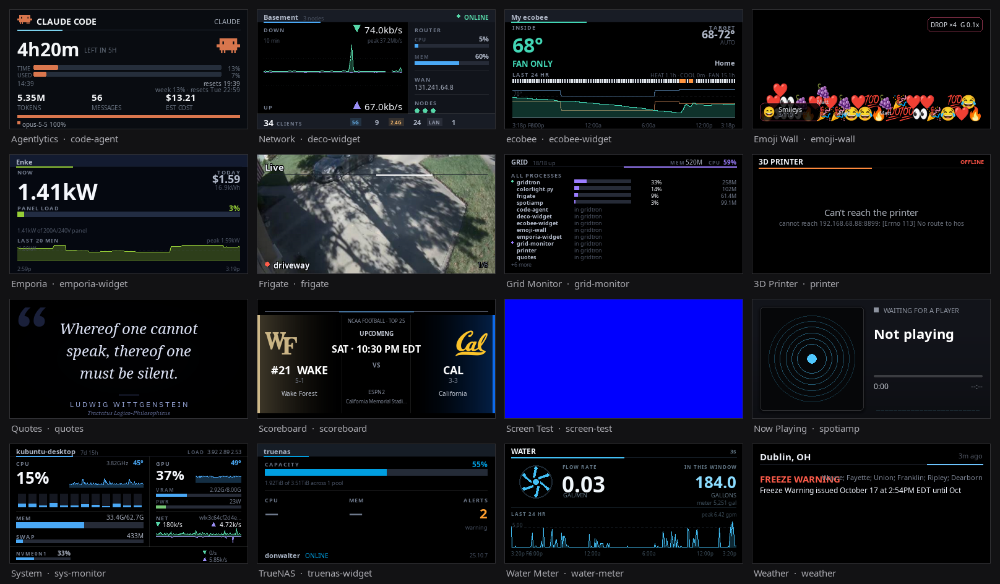
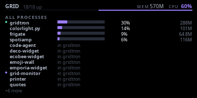
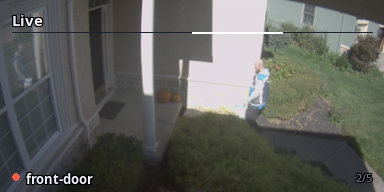
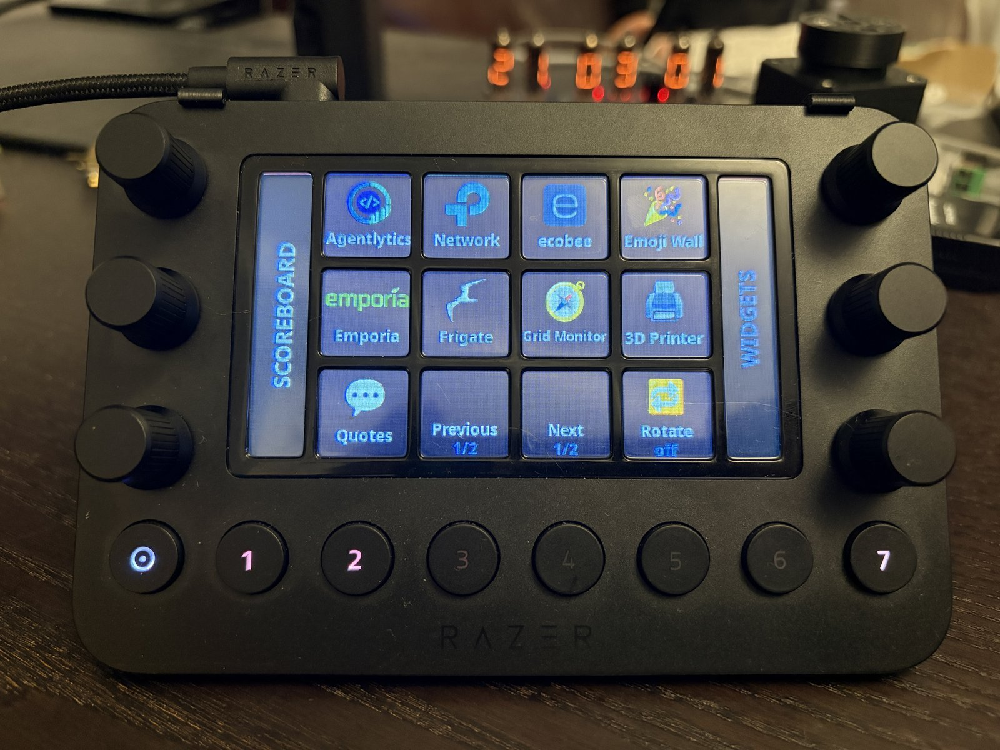

[Part one]() covered `colorlightpy`, a driver that puts any stream of raw RGB frames onto a 384×192 LED wall. It doesn't decide *what* to show, or how to switch between things without SSHing in. That's the job of [GRID](https://github.com/mtlevine0/grid): a wall of independent live widgets with a physical remote.

## What GRID is

GRID (**G**lanceable **R**egistry of **I**ndependent **D**isplays) is an orchestrator that keeps every widget running, picks which one goes to the wall, and turns a macro pad into the remote.

Everything the video wall displays comes from widgets, each built for a single purpose, like a now-playing screen or a sports scoreboard. Alongside the orchestrator, GRID provides a framework for developing new widgets and a bidirectional communication bus: the orchestrator uses it to control widgets, and widgets use it to report events of their own. The finished frames are written to standard out and piped directly into `colorlightpy`, which streams them to the wall:

```bash
./grid --headless | colorlightpy stream -i eth0 -W 384 -H 192 --pixel-format bgr
```

## One widget became sixteen



It started as a single now-playing widget, `spotiamp`, and grew to sixteen: sports scores, a system monitor, now-playing, weather, network stats, NVR camera alerts, home energy, a thermostat, TrueNAS storage, a water meter, a 3D printer, quotes, an emoji wall, a test-pattern generator, a GRID self-monitor, and `Agentlytics`, which shows Claude Code and Codex token burn per session.

## One process per widget, until it wasn't

At first every widget was **its own OS process**. That was necessity: the existing apps all had top-level modules named `layouts`, `screen` and `main`, plus their own virtualenvs, so they couldn't share an interpreter. It also meant a crashed widget couldn't take the wall down.

It was expensive, though. Every widget rendered 30 fps and pushed about 6.6 MB/s of pixels down a pipe whether or not anyone was watching. Past a dozen widgets, that was most of what the host spent.

So widgets can now declare `kind = "view"`, and fourteen of sixteen do. A small `view.py` hands the orchestrator a data provider and a screen, which load into its own interpreter. Hidden views keep polling but cost nothing to draw, so switching is still instant.

The old name collisions are handled by quarantining each widget in `sys.modules`. While a widget's `create()` runs, its directory is on `sys.path`; afterwards its modules are renamed to `_gridview.<widget>.<module>` and the directory comes off the path. The sharp edge: any import of your own code *after* `create()` returns fails. That bit repeatedly during the migration, so the rule is now absolute: all imports go at the top of the file.

A view that throws gets marked **faulted** and drops out of rotation without affecting anything else. Native crashes in the shared interpreter aren't contained, so `kind = "process"` remains first-class. `frigate` (native video decoding) and `spotiamp` (audio capture and D-Bus) stay on it.



## Widgets that ask for the wall


Originally control only ran one way: the pad tells a widget what to do. But sometimes the widget is the only one that knows something just happened. Frigate learns a camera saw a person long before anyone reaches for the pad.

Now each widget gets its own events socket, and identity comes from which socket you hold, so widgets can't impersonate each other. `focus.request` and `focus.release` drive a **stack**: the wall shows the top of it, or the normal selection when it's empty. A crashed widget's request is dropped, rotation pauses while the stack is non-empty, and picking a widget by hand clears it, so a human always wins.

Frigate grabs the wall for the camera that alerted, now-playing for fifteen seconds on a new track, the scoreboard for scoring plays, Agentlytics at usage milestones. The wall occasionally drives itself, and it's never ambiguous why.

## A "stream deck" remote control

The remote is a Razer Stream Controller. It shows up as a USB serial port and is easily programmed to display custom content. The protocol is binary frames over that port: an action code, a transaction id, then a payload of button presses, knob turns, or RGB565 framebuffer writes.

Most reference material describes three displays (left, centre, right). This unit has **one** 480×270 surface. Worse, the firmware **acks framebuffer writes to display ids that don't exist** and just doesn't update the panel.

The working layout is **12 LCD keys** rendered live with pygame, **6 dials**, **8 RGB buttons**, and **2 side strips**. The home page gives each widget a key. Past eleven widgets, two keys page through the list.


{.half}

## Running unattended

The orchestrator and the display driver are two systemd units under one `grid.slice`, with a generous memory ceiling as a safety net. Tuned limits wait for a measured baseline. `colorlightpy` also dropped `sudo` and runs with just `CAP_NET_RAW`.

SIGTERM used to raise `KeyboardInterrupt` mid-write, and a 221,184-byte frame always blocks partway through a 64 KiB pipe. The journal showed `expected 221184 bytes, got 65536` — exactly one pipe buffer — and the wall showed a torn image. Now the handler just sets a flag that's checked between frames.

The orchestrator blanks the pad before suspend and reopens it on resume. It saves the selected widget, the focus stack and the pad page, and each widget saves its own state (slate, sort column, location) through `get_state`/`set_state` on the same control bus.

## Installing a widget

A widget doesn't need to know GRID exists. A TOML manifest pointing at an app is enough:

```toml
[widget]
name    = "my-widget"
title   = "My Widget"
icon    = "📊"
accent  = "#5ac8fa"
path    = "/home/matt/Dev/somewhere/my-widget"
command = [".venv/bin/python", "main.py", "--headless", "--pixel-format", "rgb"]
socket  = "$XDG_RUNTIME_DIR/my-widget.sock"
```

Bundled widgets inside the GRID tree infer most of that. `grid-new` scaffolds a view-mode widget with a standalone `main.py`, a control bus, state hooks and a pad manifest (`--process` gives you the old shape). The developer guide is a single file you can hand straight to a coding agent.

## Where it's headed

Shared drawing code (charts, painters, color, time axes, the scrub control) now lives in a `widget-toolkit` package, guarded by 23 pixel-exact visual-regression fixtures. Next up: resource limits from real measurements, a focus channel from the wall back to widgets, softer attention requests like flashing a pad LED, and the open question of whether full process isolation can coexist with in-process efficiency.

So far, `colorlightpy` gets pixels onto cheap hardware reliably, and GRID makes that pipe feel more like a product: instant switching, a physical remote, widgets that ask for attention, and a wall that comes back from a reboot where it left off. Both are on [GitHub](https://github.com/mtlevine0).
